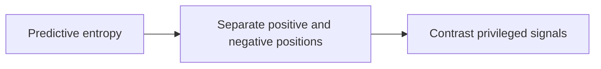
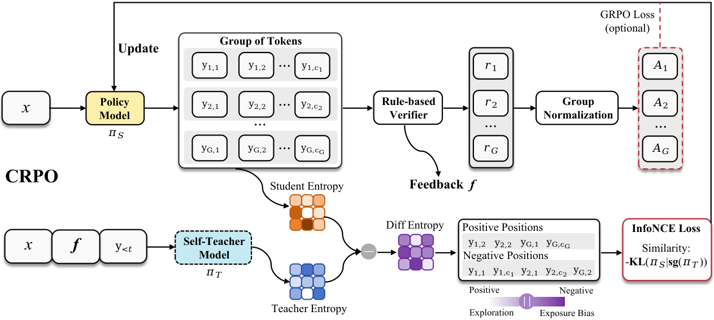

# Contrastive Reinforced Policy Optimization via Privileged Self-Distillation

<!-- source-sha256: 7f2b0c2c5273ad328156f50e361a9a619a281425f43da74ed792392bad36d5e2 -->

[简体中文](README.md)

> Candidate-policy objective, not paper-scale training.

## Paper information

| Field | Details |
|---|---|
| Paper | [Paper or original source](https://arxiv.org/abs/2607.28026) |
| Institution | No affiliation disclosed; first author Xingjian Wu. |
| First public release | 2026-07-30 (arXiv v1) |
| Author code | No public author code found as of 2026-08-24. |
| Local adapter or method key | `crpo` |
| Local reproduction code | `src/auto_research/post_training/historical_b08_b09.py` |

## Paper method and evidence

Use predictive entropy to distinguish positive reflection/exploration positions from negative exposure-bias positions, then contrast privileged self-distillation signals within groups.



<!-- paper-figure:start -->
### Original paper figure

[](https://arxiv.org/html/2607.28026v1/overview.png)

Figure shows the contrastive teacher signal. From the [original paper](https://arxiv.org/abs/2607.28026); copyright remains with the authors.
<!-- paper-figure:end -->

### Core equation

$$
\mathcal L_{CRPO}=-\log\frac{e^{s^+/\tau}}{e^{s^+/\tau}+\sum_j e^{s_j^-/\tau}}
$$

### Reported results

The paper reports consistent gains on 13 reasoning and deep-search benchmarks versus RL and self-distillation baselines.

## Local reproduction

120 updates: accuracy **0.1953→0.6484 (+0.4531)**. [Metrics](metrics/arithmetic-smoke-seed42.json), [Batch index](../../experiments/historical-b07-b11-seed42.json). Before/after arithmetic-smoke results on one candidate policy are not matched comparisons across methods. No full checkpoint, data, compute, multi-seed or benchmark. Raw outputs stay in `runs/post-training/`; [experiment artifacts](../../experiments/) contain metrics only.

```bash
auto-research post-train --algorithm crpo --dataset arithmetic-smoke --steps 120 --seed 42 --no-network
```
