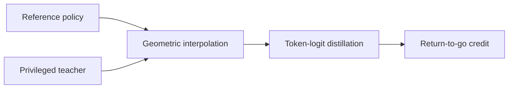
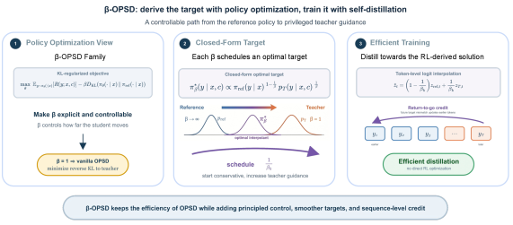

# β-OPSD: Derive self-distillation from closed-form policy optimization

<!-- source-sha256: 94b92b20f7cff25a93ac3a576deb91c58d80c57b0012938b21f82d08fc1e48e1 -->

[简体中文](README.md)

> Mechanism: reference/privileged teacher interpolation, controlled β, return-to-go; no paper Qwen3 training.

## Paper information

| Field | Details |
|---|---|
| Paper | [β-OPSD（arXiv 2607.28582）](https://arxiv.org/abs/2607.28582) |
| Institution | University of Maryland, College Park. |
| First public release | 2026-07-30 |
| Author code | No official author implementation found as of 2026-08-01. |
| Local adapter or method key | `beta-opsd` |
| Local reproduction code | [`src/auto_research/post_training/`](https://github.com/daiwk/auto-research/tree/main/src/auto_research/post_training/) |

## Paper method and evidence

Vanilla OPSD is the β=1 case of KL-regularized policy optimization. Geometrically interpolate the reference policy with the privileged teacher, convert the high-variance RL solution to token-logit distillation, and use return-to-go for long-trace credit.



<!-- paper-figure:start -->
### Original paper figure

[](https://arxiv.org/html/2607.28582v1/x1.png)

The original figure shows the policy-to-distillation derivation. From the [original paper](https://arxiv.org/abs/2607.28582); copyright remains with the authors.
<!-- paper-figure:end -->

### Core equation

$$
\tilde p_{\beta}=\operatorname{softmax}((1-w)z_{\bar\theta}+wz_T),\quad G_t=\sum_{s=t}^{T}\gamma^{s-t}(\log\pi_\theta-\log\tilde p_\beta)_s.
$$

### Reported results

Qwen3-8B mean AIME24/AIME25/HMMT25 Avg@12 is 60.18, +1.66 versus vanilla OPSD; Qwen3-4B gains +1.76. No production A/B.

## Local reproduction

Same GSM8K candidate policy, 120 steps, seed 42: accuracy **0.1719 → 0.7656 (+345.45%)** versus an untrained baseline. [Fixed metrics](../../experiments/beta-flux-opd-gsm8k-seed42.json).

```bash
auto-research post-train --algorithm beta-opsd --dataset gsm8k-candidate --maximum-examples 256 --steps 120 --seed 42
```

Candidate actions stand in for token distributions and a linear return-to-go approximates sequence positions. No Qwen3, LoRA or A6000/H200 training.
