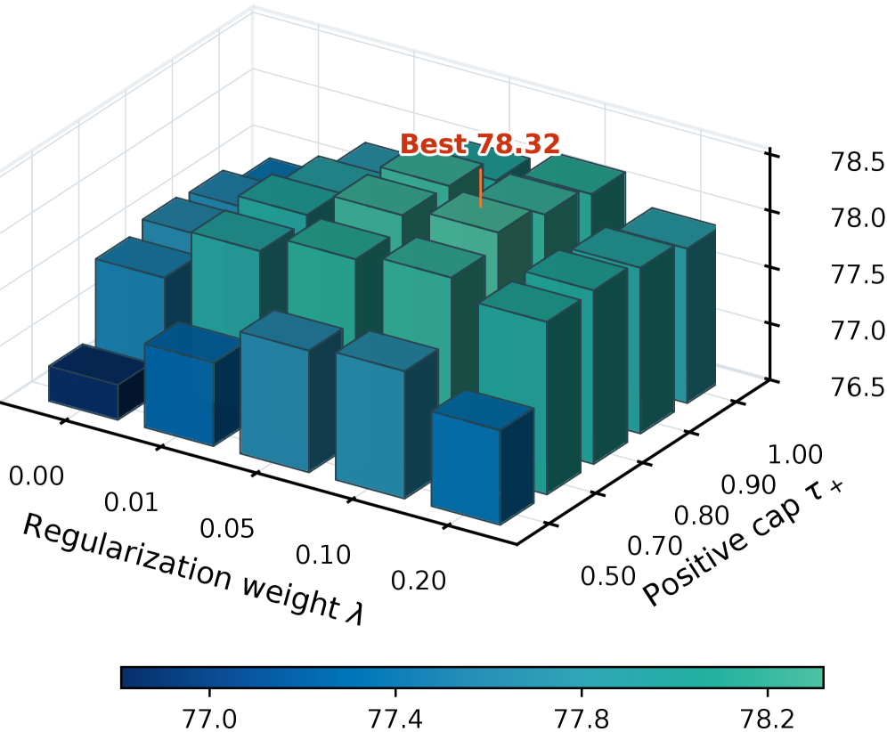

# VAD: Visual evidence attribution for multimodal on-policy distillation

<!-- source-sha256: 4a6c301e3443d4a91d873451446d2e69b999beaaab599d5a83a4218a30dc6e79 -->

[简体中文](README.md)

> **Isolated counterfactual target reconstruction.** Candidate process-quality scores proxy evidence-present/removed views; no 4B/9B multimodal model reproduction.

## Paper information

| Field | Details |
|---|---|
| Paper | [Paper or original source](https://arxiv.org/abs/2607.28590) |
| Institution | Shanghai Jiao Tong University / Xiaohongshu / CUHK / Zhejiang University / Southeast University |
| First public release | 2026-07-30 |
| Author code | Yes: [author implementation](https://github.com/DeepExperience/VAD_Multimodal_OPD) and [model weights](https://huggingface.co/zhangkangning/VAD_for_Qwen3.5-4b). |
| Local adapter or method key | `vad` |
| Local reproduction code | [`src/auto_research/post_training/`](https://github.com/daiwk/auto-research/tree/main/src/auto_research/post_training/) |

## Paper method and evidence

Privileged-view matching mixes visual evidence, language priors and teacher bias. VAD runs the same frozen teacher with and without relevant evidence; the centered log-probability difference is a signed visual direction. Project the original correction onto this direction with a one-sided constraint, then rebuild the target around the student's current distribution. The full privileged teacher remains only a weak regularizer.


<!-- paper-figure:start -->
### Original paper figure

[](https://arxiv.org/html/2607.28590v1/x3.png)

Figure 5 shows the flow of evidence views and target construction. From the [original paper](https://arxiv.org/abs/2607.28590); copyright remains with the authors.
<!-- paper-figure:end -->

### Core equation

$$
r_t=\phi_t(p_T^+)-\phi_t(p_S^0),\quad u_t=\phi_t(p_T^+)-\phi_t(p_T^-),\quad
\beta_t=\frac{[\langle r_t,u_t\rangle]_+}{\lVert u_t\rVert_2^2+\zeta},
$$

$$
q_{T,t}=\operatorname{softmax}\!\left(\phi_t(p_S^0)+\operatorname{clip}(\beta_tu_t,-c,c)\right).
$$

### Reported results

Across six visual benchmarks, Qwen3.5-4B Full VAD averages 78.32 vs 75.92 for direct privileged teacher matching. At 9B it also beats Vision-OPD and visual-advantage weighting. No production A/B.

## Local reproduction

Implements two frozen teacher forwards, centered log-probability differences, one-sided projection, supporting/refuting branch budgets, student-anchored targets, symmetric JSD and 0.1-weighted weak teacher regularization. Logs projection, evidence norm, budgets and correction alignment. GSM8K candidate seed 42 accuracy goes 0.1719→0.7969 (+363.64% from pre-training), reward 0.3124→0.8153 and reference KL 0.0092. Over 120 updates projection activates 100% with mean alignment 0.5145. This is candidate-policy mechanism evidence, not visual benchmark lift. [Fixed-seed metrics](../../experiments/latest-20260802-seed42.json). No Qwen3.5 training, image crops, visual top-100 token support or six official benchmarks.

```bash
auto-research post-train --algorithm vad --dataset gsm8k-candidate --maximum-examples 256 --steps 120 --seed 42
auto-research evolve --model post-training --dataset gsm8k-candidate --direction "Compare VAD with other OPD target reconstruction methods" --generations 2 --population 4
```
