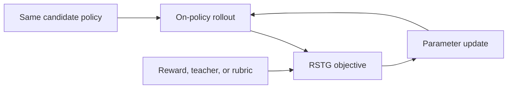
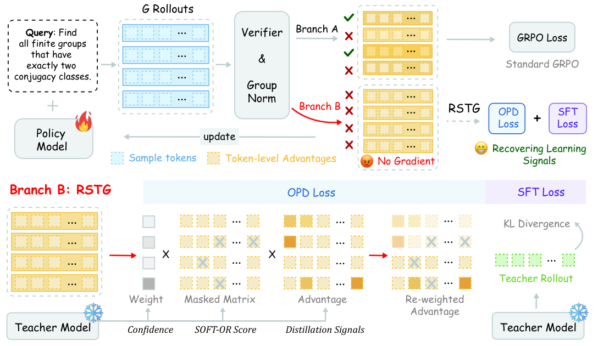

# Distill Where You Fail: Recovering Learning Signals of Negative RL-Groups from Adaptive Teacher Guidance

<!-- source-sha256: ac4f366ad454d025a916573549795e5cbd2ebfda52807a07c3f4eedce31e342d -->

[简体中文](README.md)

> **Core-objective candidate-policy mini-suite.** Executes the paper-specific advantage, distillation, or constraint update, not paper-scale large-model training.

## Paper information

| Field | Details |
|---|---|
| Paper | [arXiv 2608.00782](https://arxiv.org/abs/2608.00782) |
| Organization | Tianjin University |
| First public release | 2026-08-01 (arXiv v1) |
| Authors' code | No public author code was found as of 2026-08-24. |
| Adapter / method | `rstg` |
| Local reproduction code | `src/auto_research/post_training/historical_b08_b09.py` |
| First author | Zhuowen Han |

## Original paper

### Motivation and method

Enable the teacher only for negative zero-variance groups. Distill high-entropy or high teacher–student-gap tokens and add SFT on correct teacher trajectories.



<!-- paper-figure:start -->
### Key figure from the paper

[](https://arxiv.org/html/2608.00782v1/rstg_method.png)

> **Figure 2:** Core architecture, modules, and connections. From the [original paper](https://arxiv.org/abs/2608.00782); copyright remains with the authors.
<!-- paper-figure:end -->

### Core equation

$$
\mathcal L=\mathcal L_{GRPO}+\mathbf1[\operatorname{Var}(R)=0,R=0]\mathcal L_{OPD}
$$

### Paper results

Relative to naive GRPO+OPD, mathematics rises +4.02% and code +3.05%. These are paper results. Without an industrial A/B test, no online gains are inferred.

## Local reproduction

The same arithmetic-smoke candidate policy runs 120 updates. Accuracy changes from 0.1953 before training to 0.6797 afterward, or +0.4844. This before/after smoke run is not a matched comparison with other RL or OPD algorithms. See the [per-method metrics](metrics/arithmetic-smoke-seed42.json) and [batch index](../../experiments/historical-b07-b11-seed42.json).

```bash
auto-research post-train --algorithm rstg --dataset arithmetic-smoke --steps 120 --seed 42 --no-network
```

## Reproduction boundaries

An auditable candidate policy exercises the core objective and diagnostics. No large checkpoint was downloaded, and the full data, compute, seeds, or benchmark are not reproduced. Raw results default to runs/post-training/; only metrics are committed, not checkpoints. See [experiments](../../experiments/).
