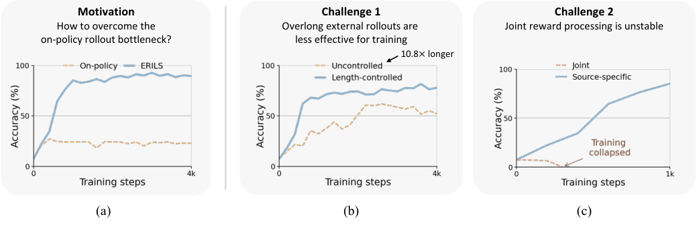

# ERILS: Beyond On-Policy Exploration with External Rollouts for Diffusion LMs

<!-- source-sha256: ceb8224fbba0f66a23b9b65abe94f744f7923f44d0776906e753496adf0324af -->

[简体中文](README.md)

> Core candidate-policy objective, not original diffusion LM training.

## Paper information

| Field | Details |
|---|---|
| Paper | [Paper or original source](https://arxiv.org/abs/2608.01717) |
| Institution | Seoul National University; first author Wonseok Lee. |
| First public release | 2026-08-03 (arXiv v1) |
| Author code | No public author code found as of 2026-08-24. |
| Local adapter or method key | `erils` |
| Local reproduction code | `src/auto_research/post_training/historical_b08_b09.py` |

## Paper method and evidence

Cap external-policy rollout length and process rewards separately by on-policy/external source to avoid collapse from joint normalization.


<!-- paper-figure:start -->
### Original paper figure

[](https://arxiv.org/html/2608.01717v1/introduction.png)

The original figure shows combining rollout sources. From the [original paper](https://arxiv.org/abs/2608.01717); copyright remains with the authors.
<!-- paper-figure:end -->

### Core equation

$$
A_i=\operatorname{Norm}_{source(i)}(R_i),\quad |y_i|\le L
$$

### Reported results

Sudoku best-of-4 98.4% versus strong baseline 40.3%; deterministic accuracy around 90% across generation lengths. Paper evidence only.

## Local reproduction

120 updates on arithmetic-smoke: **0.1953→0.5703 (+0.3750)**. [Metrics](metrics/arithmetic-smoke-seed42.json), [batch index](../../experiments/historical-b07-b11-seed42.json). Before/after on one policy is not a matched comparison. No checkpoint, full data/compute, multi-seed or benchmark. Only [metrics](../../experiments/) are committed; raw outputs stay in `runs/post-training/`.

```bash
auto-research post-train --algorithm erils --dataset arithmetic-smoke --steps 120 --seed 42 --no-network
```
