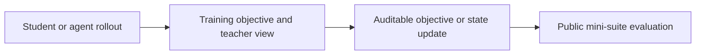
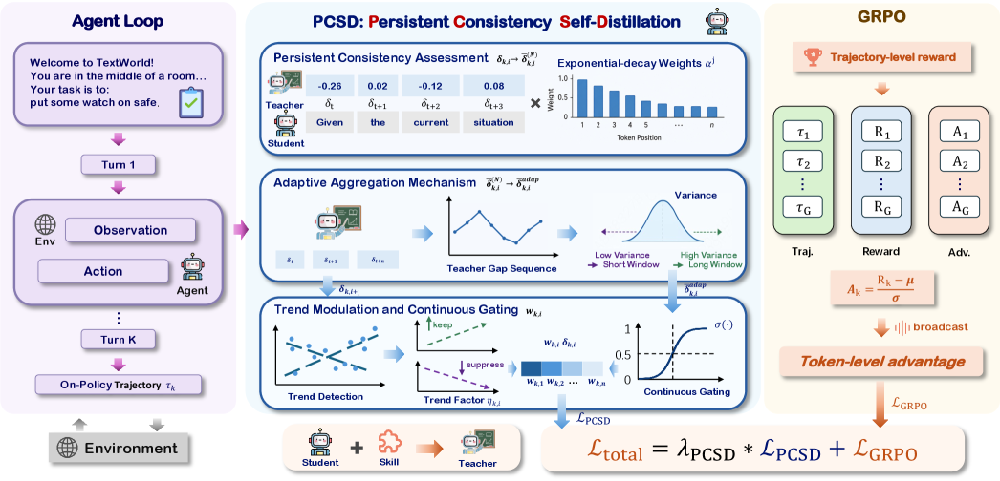

# PCSD: using persistent consistency to filter local teacher noise

<!-- source-sha256: 8073aa9055afef949440d5e5e5f95fa116fb9bb0ea2fe96199c351b5c8c4d80c -->

[简体中文](README.md)

> **Fidelity: core mechanism.** Separates original paper conclusions, local mechanism checks, and unreproduced work.

## Paper information

| Field | Details |
|---|---|
| Paper | [PCSD: Persistent Consistency for Self-Distillation in Agentic Reinforcement Learning (arXiv 2608.01837)](https://arxiv.org/abs/2608.01837) |
| Organization | No affiliation listed |
| First public release | 2026-08-03 (arXiv v1) |
| Authors' code | No official implementation was found on 2026-08-08. |
| Adapter / method | `pcsd` |
| Local reproduction code | [`src/auto_research/post_training/`](https://github.com/daiwk/auto-research/tree/main/src/auto_research/post_training/) |

## Original paper

### Motivation and method

Single-token teacher gaps are noisy, but one weight for the entire step erases positional differences. PCSD exponentially accumulates teacher-favoring evidence in an adaptive window and decays falling trends. A continuous sigmoid gate is trained jointly with GRPO.



<!-- paper-figure:start -->
### Key figure from the paper

[](https://arxiv.org/html/2608.01837v1/x1.png)

> **Figure 2:** Core architecture, modules, and connections. From the [original paper](https://arxiv.org/abs/2608.01837); copyright remains with the authors.
<!-- paper-figure:end -->

### Core equations

$$
s_t=\log\pi_T(y_t)-\log\pi_S(y_t),\quad p_t=\beta p_{t-1}+(1-\beta)s_t,\quad g_t=\sigma(p_t\,m_t),\quad \mathcal L=\mathcal L_{GRPO}+\lambda\sum_tg_t\mathcal L_{OPSD,t}.
$$

### Paper results

On ALFWorld, two backbones beat GRPO by 15.6/13.3 points and SDAR by 6.2/5.5 points. No production A/B is reported.

## Local reproduction

The implementation uses exponentially accumulated evidence, trend decay, and continuous gating. Candidate positions stand in for token positions.

Arithmetic candidate suite, 120 steps, seed 42: accuracy 0.2344 → **0.5625 (+140.00%)**. The [fixed metrics](../../experiments/p0-p1-closed-audit-20260808-seed42.json) retain all diagnostic fields.

```bash
auto-research post-train --algorithm pcsd --dataset arithmetic-smoke --maximum-examples 256 --steps 120 --seed 42
auto-research evolve --model post-training --dataset arithmetic-smoke --direction "组合 pcsd 与已安装论文算子" --generations 2 --population 4
```

## Reproduction boundaries

A deterministic public mini-suite checks core state updates and fair budgets. It does not reproduce the original large model, multi-GPU RL, private environment, or full benchmark. Local changes and paper gains remain separate.
