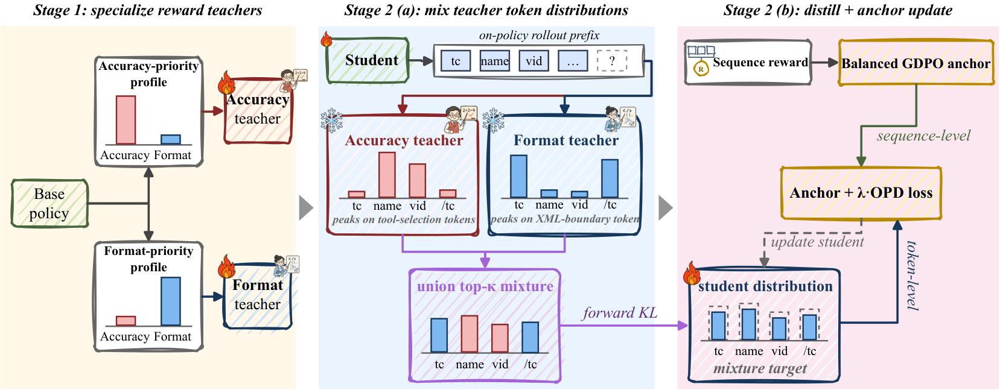

# SMOPD: Multi-Reward Reinforcement Learning via Specialize-and-Merge Online Policy Distillation

<!-- source-sha256: 7902b95aabab9a9465c10889cd3baf47a64a058285fbfb1d64939f83965b73ae -->

[简体中文](README.md)

> Candidate-policy objective, not paper-scale training.

## Paper information

| Field | Details |
|---|---|
| Paper | [Paper or original source](https://arxiv.org/abs/2608.03092) |
| Institution | Alibaba / Qwen; first author Wen Wang. |
| First public release | 2026-08-04 (arXiv v1) |
| Author code | No public author code found as of 2026-08-24. |
| Local adapter or method key | `smopd` |
| Local reproduction code | `src/auto_research/post_training/historical_b08_b09.py` |

## Paper method and evidence

Train specialist teachers with reward priorities, then merge their capabilities on the student's own trajectories.


<!-- paper-figure:start -->
### Original paper figure

[](https://arxiv.org/html/2608.03092v2/mopd_framework_v9.png)

The original figure shows specialize-and-merge distillation. From the [original paper](https://arxiv.org/abs/2608.03092); copyright remains with the authors.
<!-- paper-figure:end -->

### Core equation

$$
\mathcal L=\sum_k\alpha_kD_{KL}(p_{T_k}\Vert p_\theta)
$$

### Reported results

The paper beats GDPO for complementary and conflicting rewards on 1.5B/3B/7B backbones. No online inference.

## Local reproduction

120 updates: accuracy **0.1953→0.3125 (+0.1172)**. [Metrics](metrics/arithmetic-smoke-seed42.json), [Batch index](../../experiments/historical-b07-b11-seed42.json). Before/after arithmetic-smoke results on one candidate policy are not matched comparisons across methods. No full checkpoint, data, compute, multi-seed or benchmark. Raw outputs stay in `runs/post-training/`; [experiment artifacts](../../experiments/) contain metrics only.

```bash
auto-research post-train --algorithm smopd --dataset arithmetic-smoke --steps 120 --seed 42 --no-network
```
