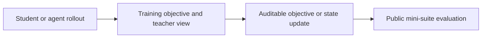
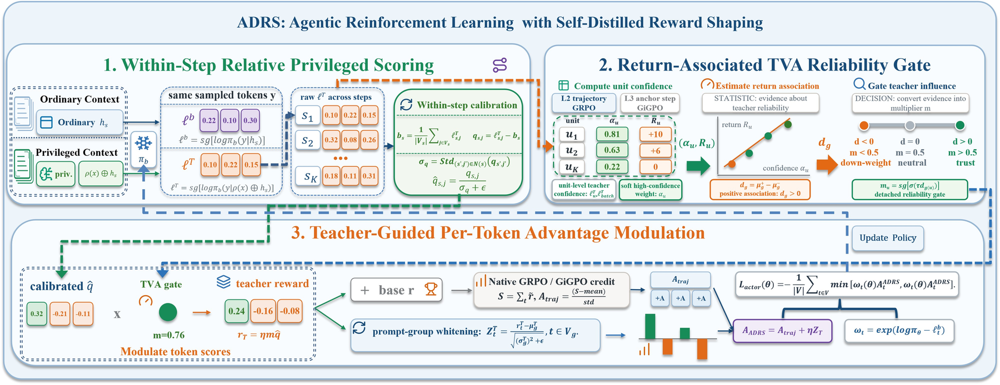

<!-- source-sha256: 85e9eb103f8e5d9df3832f03415bcdfb1f1da30587ae47cba86998792764c409 -->

[简体中文](README.md) · English

# ADRS: Return-correlated self-distilled reward shaping

> **Core mechanism reproduction.** Paper conclusions, local verification and unreproduced scope are separate.

## Paper information

| Field | Details |
| --- | --- |
| Paper | [Agentic Reinforcement Learning with Self-Distilled Reward Shaping (arXiv 2608.03223)](https://arxiv.org/abs/2608.03223) |
| Institution | University of Science and Technology of China / Alibaba Group |
| First public release | 2026-08-04 (arXiv v1) |
| Author code | [Released code: gitrxh/ADRS-arxiv](https://github.com/gitrxh/ADRS-arxiv). |
| Local adapter or method key | `adrs` |
| Local reproduction code | [`src/auto_research/post_training/`](https://github.com/daiwk/auto-research/tree/main/src/auto_research/post_training/) |

## Original paper summary

### Background and main changes

Privileged teacher confidence need not agree with actual task return. ADRS normalizes teacher scores within each interaction step, gates them by correlation with realized returns, then injects the gated token signal into the native reward-to-advantage path. No skills are needed at inference.



<!-- paper-figure:start -->
### Key figure from the paper

[](https://arxiv.org/html/2608.03223v1/figures/framework/ADRS2.jpg)

> **Figure 2:** Training workflow and key optimizations. From the [paper](https://arxiv.org/abs/2608.03223); copyright belongs to the authors. Click for the source.
<!-- paper-figure:end -->

### Core equations

$$
z_{i,t}=(s_{i,t}-\mu_t)/(\sigma_t+\epsilon),\quad g_t=[\operatorname{corr}(z_{\cdot,t},R)]_+,\quad A'_{i,t}=A_i+\lambda g_tz_{i,t}.
$$

### Offline and online results

The paper reports consistent gains across three interactive benchmarks, several RL backbones, low-data conditions and unseen tasks. No single aggregate is given in the abstract, and no production A/B is reported.

## Local reproduction

Implements within-step centering, return association, the TVA gate and native REINFORCE advantage injection.

Arithmetic candidate suite, 120 steps, seed 42: accuracy 0.2344 → **0.6250 (+166.67%)**. Diagnostic fields are in the pinned metrics.

```bash
auto-research post-train --algorithm adrs --dataset arithmetic-smoke --maximum-examples 256 --steps 120 --seed 42
auto-research evolve --model post-training --dataset arithmetic-smoke --direction "组合 adrs 与已安装论文算子" --generations 2 --population 4
```

See [stable batch metrics](../../experiments/p0-p1-closed-audit-20260808-seed42.json).

## Scope

The deterministic public mini-suite checks core state updates at matched budgets. It does not reproduce large models, multi-GPU RL, private environments or the full benchmark. Local relative changes are not paper gains.
