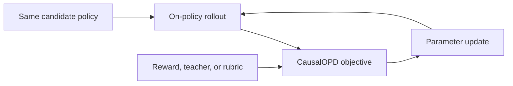
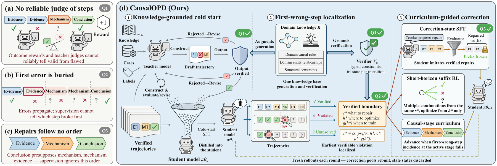

# CausalOPD: First-Wrong-Step Supervision for Distilling Causal Chain Reasoning

<!-- source-sha256: e3f22ca18f528e5fc4b315d77e8fdfa572cfebfb052e7a6dbfbfaa88e3165340 -->

[简体中文](README.md)

> **Core-objective candidate-policy mini-suite.** Executes the paper-specific advantage, distillation, or constraint update, not paper-scale large-model training.

## Paper information

| Field | Details |
|---|---|
| Paper | [arXiv 2608.03673](https://arxiv.org/abs/2608.03673) |
| Organization | The authors do not disclose an affiliation |
| First public release | 2026-08-04 (arXiv v1) |
| Authors' code | No public author code was found as of 2026-08-24. |
| Adapter / method | `causal-opd` |
| Local reproduction code | `src/auto_research/post_training/historical_b08_b09.py` |
| First author | Jian Zhang |

## Original paper

### Motivation and method

The teacher identifies the first incorrect step in the on-policy causal chain, repairs it with short-horizon RL, and advances the curriculum from evidence through mechanism to conclusion.



<!-- paper-figure:start -->
### Key figure from the paper

[](https://arxiv.org/html/2608.03673v1/fig1_overview_v10.png)

> **Figure 1:** Overall workflow, stages, and data flow. From the [original paper](https://arxiv.org/abs/2608.03673); copyright remains with the authors.
<!-- paper-figure:end -->

### Core equation

$$
t^*=\min\{t:C(s_t,a_t)=0\}
$$

### Paper results

Across three domains, average path correctness rises +23.4 points versus sequence OPD and RLWR falls from 15.7% to 4.4%. These are paper results. Without an industrial A/B test, no online gains are inferred.

## Local reproduction

The same arithmetic-smoke candidate policy runs 120 updates. Accuracy changes from 0.1953 before training to 0.6328 afterward, or +0.4375. This before/after smoke run is not a matched comparison with other RL or OPD algorithms. See the [per-method metrics](metrics/arithmetic-smoke-seed42.json) and [batch index](../../experiments/historical-b07-b11-seed42.json).

```bash
auto-research post-train --algorithm causal-opd --dataset arithmetic-smoke --steps 120 --seed 42 --no-network
```

## Reproduction boundaries

An auditable candidate policy exercises the core objective and diagnostics. No large checkpoint was downloaded, and the full data, compute, seeds, or benchmark are not reproduced. Raw results default to runs/post-training/; only metrics are committed, not checkpoints. See [experiments](../../experiments/).
