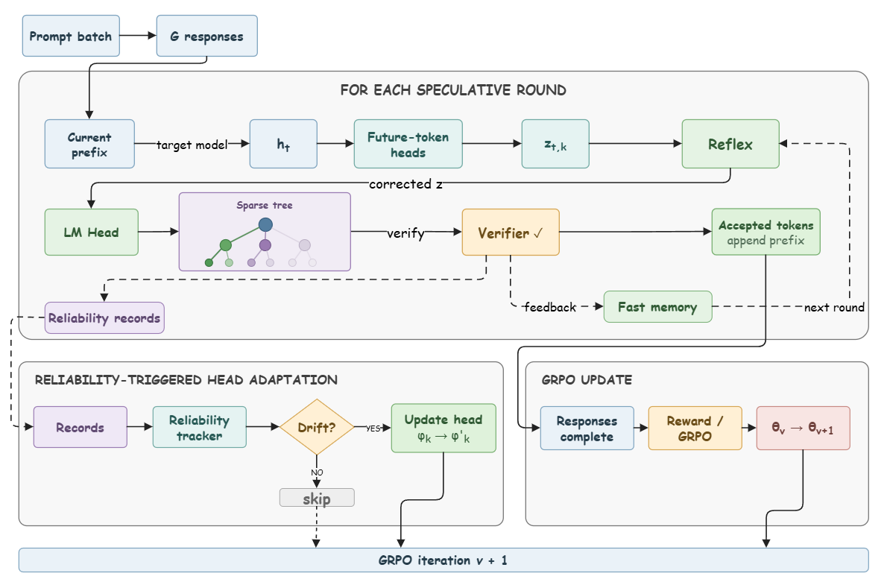

# SpecRoll: Fast-Slow Verifier-Feedback Adaptation for Speculative Reinforcement Learning Rollouts

<!-- source-sha256: 9a09d7f6f0abca554ebfe7413ef774b45dc7165d39432898793ce0076b933a74 -->

[简体中文](README.md)

> **Reproduction level: core-mechanism mini-suite.** Exercises the paper-specific rollout acceleration mechanism, not a full paper reproduction.

## Paper information

| Field | Details |
|---|---|
| Paper | [arXiv 2608.04962](https://arxiv.org/abs/2608.04962) |
| Organization | VNU University of Engineering and Technology / Viettel AI |
| First public release | 2026-08-05 (arXiv v1) |
| Authors' code | [Released through the author artifact](https://anonymous.4open.science/r/SpecRoll-26062006). |
| Adapter / method | `specroll` |
| Local reproduction code | [`src/auto_research/post_training/latest_20260809.py`](https://github.com/daiwk/auto-research/blob/main/src/auto_research/post_training/latest_20260809.py) |

**Version boundary (2026-10-15 review).** This page and `specroll` preserve v1's fast/slow mechanism, not [v2 SPARK](https://arxiv.org/html/2608.04962v2). SPARK shares low-rank logit correction within a prompt group, resets it each round, updates it from verifier feedback, and learns projections across rollouts. Renaming the old adapter does not implement v2. The full v2 multimodel GRPO study is not reproduced; review is complete and the mini-suite evidence grade is unchanged.

## Original paper

### Motivation and method

RL's changing target policy quickly makes a static drafter stale. SpecRoll proposes with future-token heads, corrects hidden states through a no-backpropagation fast Reflex path, and activates slow head updates only under sustained degradation. An exact verifier preserves the sampling distribution.

### Architecture


<!-- paper-figure:start -->
### Key figure from the paper

[](https://arxiv.org/html/2608.04962v1/figures/overview.png)

> **Figure 2:** Overall design and key components. From the [original paper](https://arxiv.org/abs/2608.04962); copyright remains with the authors.
<!-- paper-figure:end -->

### Core equation

$\alpha=\min(1,p_\theta(y)/q_\phi(y)),\qquad \mathcal L_{GRPO}\ \text{unchanged}$

### Paper results

Five models from 1.5B to 14B and three math datasets show 1.26×–2.15× generation and 1.21×–2.04× end-to-end speedups.

## Local reproduction

See [stable metrics](metrics/arithmetic-smoke-seed42.json). Checkpoints and raw outputs are not committed.

```bash
auto-research post-train --algorithm specroll --dataset arithmetic-smoke --steps 120 --seed 42
```

> **Local comparison.** `specroll` versus a control without the mechanism on the same public mini-suite. Only local artifact metrics are reported; full-scale paper results are not imported as local gains.

## Limits

- Reproduces a paper-specific state, credit, or selection operator, not just a name.
- Original large models, proprietary environments, and costly judges are not run or labeled integrated.
- `specroll` participates in unified Evolve candidate discovery, with combined genomes subject to public evaluation and budgets.
