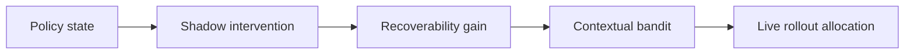
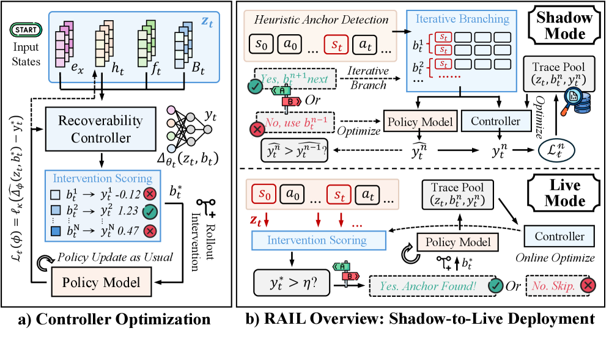

# Optimizing What Policies Learn From: Recoverability-Aware Rollout Intervention Learning

<!-- source-sha256: 1e60cba323dbe55dc7d133e062a7458d611618abd1e81c797b73fd5410e4aaf2 -->

[简体中文](README.md)

> **Core-mechanism mini-suite.** Runs the rollout-budget allocation operator. A small deterministic evaluation is not a full reproduction.

## Paper information

| Field | Details |
|---|---|
| Paper | [arXiv 2608.05080](https://arxiv.org/abs/2608.05080) |
| Organization | University of Notre Dame / Amazon |
| First public release | 2026-08-05 (arXiv v1) |
| Authors' code | No public author code was found on 2026-08-09. |
| Adapter / method | `rail` |
| Local reproduction code | [`src/auto_research/post_training/latest_20260809.py`](https://github.com/daiwk/auto-research/blob/main/src/auto_research/post_training/latest_20260809.py) |

## Original paper

### Motivation and method

**Topic: rollout-budget allocation.** Uniform rollouts waste budget, and static heuristics cannot track a changing policy. RAIL treats intervention timing and type as a contextual bandit and learns a recoverability controller from shadow-to-live trajectories.

### Architecture



<!-- paper-figure:start -->
### Key figure from the paper

[](https://arxiv.org/html/2608.05080v1/x2.png)

> **Figure 2:** Core architecture, modules, and connections. From the [original paper](https://arxiv.org/abs/2608.05080); copyright remains with the authors.
<!-- paper-figure:end -->

### Core equation

$a^*(s)=\arg\max_a\mathbb E[\Delta R_{recover}(s,a)-\lambda C(a)]$.

### Paper results

Under constrained rollout budgets, RAIL consistently beats uniform GRPO and adaptive baselines. The abstract does not give a single aggregate gain.

## Local reproduction

See the [stable metrics](metrics/arithmetic-smoke-seed42.json). Checkpoints and raw run directories are not committed.

```bash
auto-research post-train --algorithm rail --dataset arithmetic-smoke --steps 120 --seed 42
```

> **Local comparison:** Compare RAIL with a control without the mechanism in the same public mini-suite. Report only local artifact metrics; large-model and real-environment paper results are not local gains.

## Reproduction boundaries

- Implements the paper-specific state, credit, or selection operator, not merely a renamed method.
- No original large model, proprietary environment, or expensive judge was run; these are not marked integrated.
- RAIL participates in unified evolve candidate discovery. Composed genomes remain subject to public evaluation and budget constraints.
