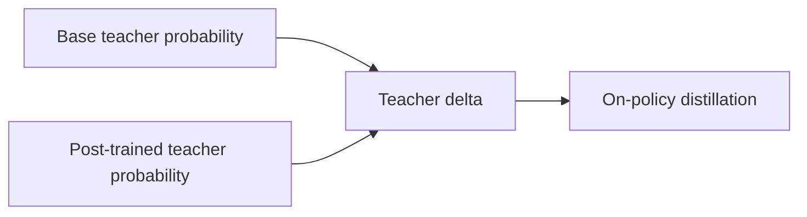
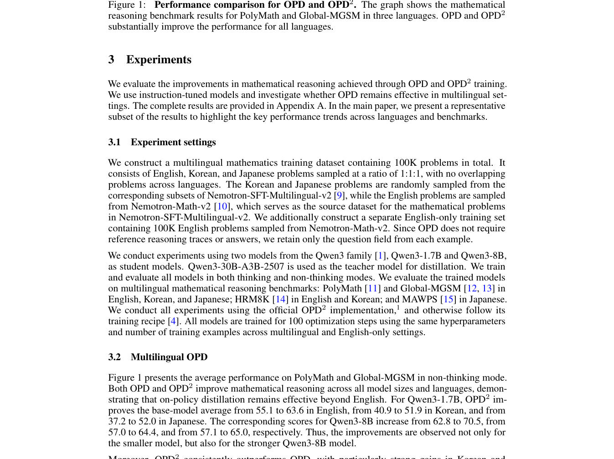

# On-Policy Delta Distillation for Multilingual Math Reasoning

<!-- source-sha256: fab776cdcbbef8adfcd2ffa8a6ad5ee4c4bd53ab95d1cc7f73f0261a19894fd3 -->

[简体中文](README.md)

> Core candidate-policy objective; not large-model multilingual training.

## Paper information

| Field | Details |
|---|---|
| Paper | [arXiv 2608.05802](https://arxiv.org/abs/2608.05802) |
| Institution | NAVER AI Lab; first author Byeongho Heo. |
| First public release | 2026-08-06 (arXiv v1) |
| Author code | [naver-ai/opd2](https://github.com/naver-ai/opd2). |
| Local adapter or method key | `opd2` |
| Local reproduction code | `src/auto_research/post_training/historical_b08_b09.py` |

## Paper method and evidence

Distill the probability change of a post-trained teacher relative to its base model, reducing replication of pre-existing teacher biases.



<!-- paper-figure:start -->
### Original paper figure

[](https://arxiv.org/pdf/2608.05802#page=3)

The original figure contrasts base and post-trained teacher signals. From the [original paper](https://arxiv.org/abs/2608.05802); copyright remains with the authors.
<!-- paper-figure:end -->

### Core equation

$$
\Delta_T=\log p_{T^+}-\log p_{T^0}
$$

### Reported results

The paper reports consistent gains over OPD on Qwen3, especially in Korean and Japanese. No production A/B inference.

## Local reproduction

```bash
auto-research post-train --algorithm opd2 --dataset arithmetic-smoke --steps 120 --seed 42 --no-network
```

Same arithmetic-smoke candidate policy, 120 updates: accuracy **0.1953→0.6406 (+0.4453)**, a before/after smoke result rather than a fair cross-method comparison. [Metrics](metrics/arithmetic-smoke-seed42.json), [batch index](../../experiments/historical-b07-b11-seed42.json). No original checkpoint, full data, compute, multi-seed or benchmarks. `runs/post-training/` stores raw local outputs; only metrics are committed. See [experiment artifacts](../../experiments/).
