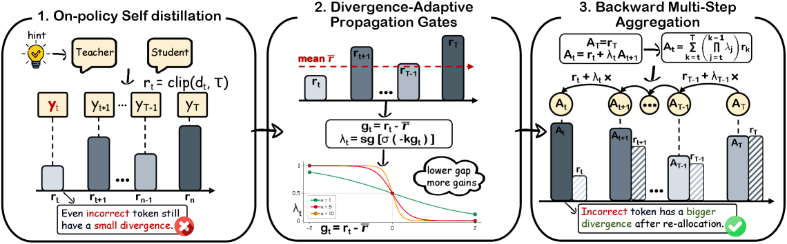

# DASH: dynamically adaptive self-distillation horizon

<!-- source-sha256: 4c1be20eca914d92f87aa4a47f16a2942e0ed114d242fc4fe232ef1acfd87ce5 -->

[简体中文](README.md)

> **Fidelity: core mechanism.** Implements clipped local divergence, a stop-gradient gate, and backward horizon aggregation; candidate positions stand in for token positions.

## Paper information

| Field | Details |
|---|---|
| Paper | [DASH (arXiv 2608.06243)](https://arxiv.org/abs/2608.06243) |
| Organization | Nanjing University |
| First public release | 2026-08-06 (arXiv v1) |
| Authors' code | [DBtxy/DASH-OPSD](https://github.com/DBtxy/DASH-OPSD) is public. |
| Adapter / method | `dash` |
| Local reproduction code | [`src/auto_research/post_training/`](https://github.com/daiwk/auto-research/tree/main/src/auto_research/post_training/) |

## Original paper

### Motivation and method

Ordinary OPSD matches the privileged teacher separately at each token, making it hard to propagate credit from reliable later reasoning to earlier decisions. DASH uses local teacher/student divergence to form a stop-gradient gate and recursively aggregates weights backward. It obtains an adaptive distillation horizon without extra teacher forward passes.


<!-- paper-figure:start -->
### Key figure from the paper

[](https://arxiv.org/html/2608.06243v1/x4.png)

> **Figure 2:** Overview of the paper's method and key components. From the [original paper](https://arxiv.org/abs/2608.06243); copyright remains with the authors.
<!-- paper-figure:end -->

### Core equations

$$
\lambda_t=\operatorname{sg}\sigma[-\kappa(d_t-\bar d)],\qquad
A_t=d_t+\lambda_t A_{t+1},\qquad \mathcal L=\frac1T\sum_t A_t.
$$

### Paper results

Qwen3-1.7B averages 45.07 against 41.87 for OPSD; 4B scores 65.00 versus 63.60, and 8B 66.40 versus 64.80. No production A/B is reported.

## Local reproduction

Arithmetic candidate suite, 120 steps, seed 42: accuracy 0.2344 → **0.5781 (+146.67%)**; final mean gate 0.4822, mean horizon coefficient 1.5617, and zero extra teacher forwards.

```bash
auto-research post-train --algorithm dash --dataset arithmetic-smoke --maximum-examples 256 --steps 120 --seed 42
auto-research evolve --model post-training --dataset arithmetic-smoke --direction "比较 OPSD 与 DASH 自适应 horizon" --generations 2 --population 4
```

See the [fixed metrics](../../experiments/dash-arithmetic-seed42.json).

## Reproduction boundaries

Candidate positions are not complete token trajectories. Qwen3, mathematics reasoning data, and multi-GPU training were not reproduced.
