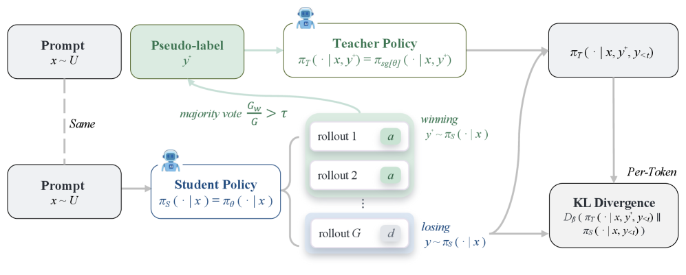

<!-- source-sha256: fb62ddcdee4c31f183846769805fe6e55776fd773829b792400a361a26d871b6 -->

[简体中文](README.md) · English

# U-OPSD: On-policy self-distillation without external supervision

> **Core mechanism reproduction.** Paper results, local verification and unreproduced scope are separate.

## Paper information

| Field | Details |
| --- | --- |
| Paper | [On-Policy Self-Distillation without Any Supervision (arXiv 2608.06296)](https://arxiv.org/abs/2608.06296) |
| Institution | University of California, San Diego / Georgia Institute of Technology / University of Maryland / ByteDance |
| First public release | 2026-08-06 (arXiv v1) |
| Author code | No released official code found on 2026-08-08. |
| Local adapter or method key | `u-opsd` |
| Local reproduction code | [`src/auto_research/post_training/`](https://github.com/daiwk/auto-research/tree/main/src/auto_research/post_training/) |

## Original paper summary

### Background and main changes

U-OPSD uses no answers, environment rewards or larger teacher. Sample repeatedly, majority-vote, and use the shortest agreeing solution as a privileged view to repair the longest high-confidence wrong trajectory. Self-distillation relies on internal consistency.


<!-- paper-figure:start -->
### Key figure from the paper

[](https://arxiv.org/html/2608.06296v1/x2.png)

> **Figure 2:** Overall design and components. From the [paper](https://arxiv.org/abs/2608.06296); copyright belongs to the authors. Click for the source.
<!-- paper-figure:end -->

### Core equations

$$
\hat y=\operatorname{mode}\{y^{(k)}\}_{k=1}^K,\quad c=K^{-1}\sum_k\mathbf1[y^{(k)}=\hat y],\quad \mathcal L=\mathbf1[c\ge\tau]\operatorname{KL}(\pi(\cdot|x,\hat y)\Vert\pi(\cdot|x)).
$$

### Offline and online results

Non-thinking Qwen3 4B/8B gain 8.5/10.7 points over base and 3.2/2.3 points over OPSD on average. No production A/B.

## Local reproduction

Implements multi-rollout self-consistency voting, confidence gating and a gold-free pseudo-teacher. The unsupervised assumption does not hold in the arithmetic mini-suite, so the regression is retained.

Arithmetic candidate suite, 120 steps, seed 42: accuracy 0.2344 → **0.0938 (-60.00%)**. Diagnostic fields are in pinned metrics.

```bash
auto-research post-train --algorithm u-opsd --dataset arithmetic-smoke --maximum-examples 256 --steps 120 --seed 42
auto-research evolve --model post-training --dataset arithmetic-smoke --direction "组合 u-opsd 与已安装论文算子" --generations 2 --population 4
```

See [stable batch metrics](../../experiments/p0-p1-closed-audit-20260808-seed42.json).

## Scope

The deterministic public mini-suite verifies core state updates at matched budgets, not paper-scale models, multi-GPU RL, private environments or full benchmarks. Local changes are not paper gains.
