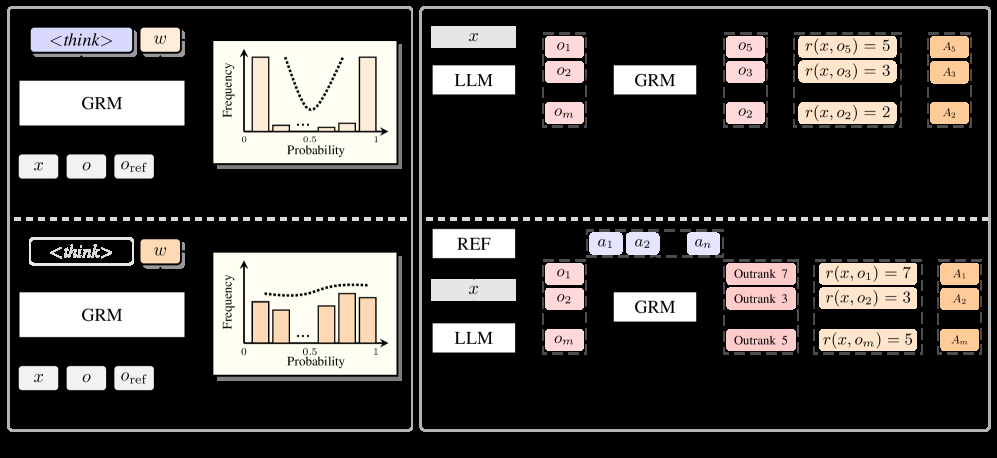

# RRC: Ranking-Based Reward Construction for Generative Reward Models

<!-- source-sha256: f8567ce8446c00cb0afaaa4e52e01592d81e03a807680241ca684d7976d92f29 -->

[简体中文](README.md)

> Core reward operator mini-suite, not full paper reproduction.

## Paper information

| Field | Details |
|---|---|
| Paper | [Paper or original source](https://arxiv.org/abs/2608.06310) |
| Institution | Northeastern University. |
| First public release | 2026-08-06 (arXiv v1) |
| Author code | [wangclnlp/RRC](https://github.com/wangclnlp/RRC). |
| Local adapter or method key | `rrc` |
| Local reproduction code | [`src/auto_research/post_training/latest_20260809.py`](https://github.com/daiwk/auto-research/blob/main/src/auto_research/post_training/latest_20260809.py) |

## Paper method and evidence

Generative reward models compare outputs better than they assign independent scalars. RRC constructs centered reward with group self-competition and a small anchor ranking.


<!-- paper-figure:start -->
### Original paper figure

[](https://arxiv.org/html/2608.06310v1/x2.png)

The original figure shows ranking-based reward construction. From the [original paper](https://arxiv.org/abs/2608.06310); copyright remains with the authors.
<!-- paper-figure:end -->

### Core equation

$r_i=\frac{\operatorname{rank}(y_i)-\bar r}{K-1}+\lambda r_i^{anchor}$.

### Reported results

AlpacaEval2 rises from 35.8% to 41.3%; ArenaHardV2 from 8.0% to 11.2% in the paper.

## Local reproduction

Compare with the same public mini-suite without RRC. [Arithmetic metrics](metrics/arithmetic-smoke-seed42.json); no original model, proprietary environment or expensive judge. Evolve candidate discovery includes RRC; combinations remain bounded by public evaluations. No raw runs or checkpoints committed.

```bash
auto-research post-train --algorithm rrc --dataset arithmetic-smoke --steps 120 --seed 42
```
