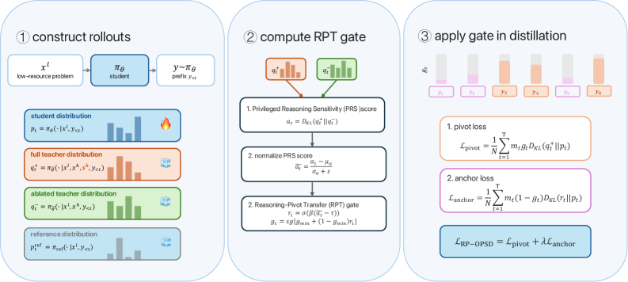

<!-- source-sha256: 9ae6d218afef6e70554a10a160b6ac524e98d281dbec7f7f27183f544fd420fc -->

[简体中文](README.md) · English

# RP-OPSD: Multilingual reasoning transfer guided by reasoning pivots

> **Core mechanism reproduction.** Paper conclusions, local verification and unreproduced scope are separate.

## Paper information

| Field | Details |
| --- | --- |
| Paper | [RP-OPSD: Reasoning-Pivot-Guided On-Policy Self-Distillation for Multilingual Reasoning Transfer (arXiv 2608.06347)](https://arxiv.org/abs/2608.06347) |
| Institution | Nanjing University / Xinye Wang |
| First public release | 2026-08-06 (arXiv v1) |
| Author code | [Released: NJUNLP/RP-OPSD](https://github.com/NJUNLP/RP-OPSD). |
| Local adapter or method key | `rp-opsd` |
| Local reproduction code | [`src/auto_research/post_training/`](https://github.com/daiwk/auto-research/tree/main/src/auto_research/post_training/) |

## Original paper summary

### Background and main changes

Surface wording and tokens that change the reasoning state should not receive equal weight in cross-language transfer. RP-OPSD compares matched teacher views with and without an English reference solution, finds pivots by distribution shift, and strengthens privileged distillation there while retaining a reference anchor.


<!-- paper-figure:start -->
### Key figure from the paper

[](https://arxiv.org/html/2608.06347v1/x2.png)

> **Figure 2:** Overall workflow, stages and data flow. From the [paper](https://arxiv.org/abs/2608.06347); copyright belongs to the authors. Click for the source.
<!-- paper-figure:end -->

### Core equations

$$
g_t=\operatorname{norm}(|\log\pi_T(\cdot|r)-\log\pi_T(\cdot|\varnothing)|),\quad q_t=(1-g_t)\pi_S+g_t\pi_T^r,\quad \mathcal L=\sum_t\operatorname{CE}(q_t,\pi_S).
$$

### Offline and online results

The paper covers 17 languages and several levels of math difficulty and generally surpasses strong multilingual reasoning baselines and OPSD variants. No production A/B.

## Local reproduction

Implements reference-conditioned and ablated views, pivot gating and a reference anchor.

Arithmetic candidate suite, 120 steps, seed 42: accuracy 0.2344 → **0.5938 (+153.33%)**. Diagnostic fields are retained in the pinned metrics.

```bash
auto-research post-train --algorithm rp-opsd --dataset arithmetic-smoke --maximum-examples 256 --steps 120 --seed 42
auto-research evolve --model post-training --dataset arithmetic-smoke --direction "组合 rp-opsd 与已安装论文算子" --generations 2 --population 4
```

See [stable batch metrics](../../experiments/p0-p1-closed-audit-20260808-seed42.json).

## Scope

The deterministic public mini-suite checks core state updates at matched budgets, not the paper's large models, multi-GPU RL, private environments or full benchmarks. Local relative changes are not paper gains.
