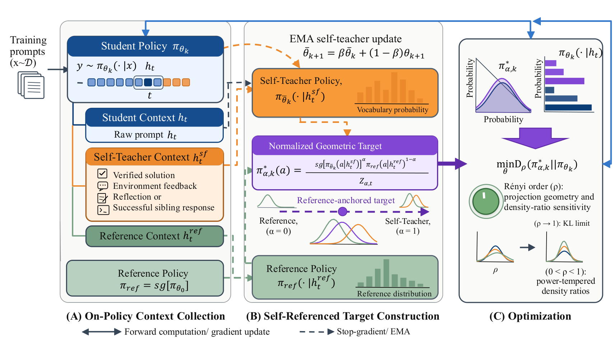

# SR-OPSD: Self-Referenced On-Policy Self-Distillation

<!-- source-sha256: 4460f2bcedca450cafb3f326134144597d773e16f7116dbc4e412ba4a9060445 -->

[简体中文](README.md)

> Candidate-policy objective diagnostic, not paper-scale distillation.

## Paper information

| Field | Details |
|---|---|
| Paper | [Paper or original source](https://arxiv.org/abs/2608.09745) |
| Institution | Independent researcher Zhuo Sun. |
| First public release | 2026-08-10 (arXiv v1) |
| Author code | No public author code found as of 2026-08-24. |
| Local adapter or method key | `sr-opsd` |
| Local reproduction code | `src/auto_research/post_training/historical_b08_b09.py` |

## Paper method and evidence

Geometrically interpolate self-teacher and reference to obtain an effective target. Rényi divergence controls projection geometry and density-ratio sensitivity.


<!-- paper-figure:start -->
### Original paper figure

[](https://arxiv.org/html/2608.09745v1/illustration_of_method.png)

Figure shows self-referenced target construction. From the [original paper](https://arxiv.org/abs/2608.09745); copyright remains with the authors.
<!-- paper-figure:end -->

### Core equation

$$
q_\beta(y)\propto p_T(y)^\beta p_{ref}(y)^{1-\beta}
$$

### Reported results

The paper reports competitive or state-of-the-art results across models and science, math and code tasks. No online evidence inferred.

## Local reproduction

Same arithmetic-smoke candidate policy, 120 updates: **0.1953→0.6797 (+0.4844)**, not a fair cross-method comparison. [Metrics](metrics/arithmetic-smoke-seed42.json), [batch index](../../experiments/historical-b07-b11-seed42.json). No original checkpoint, full training, multi-seed or benchmarks; `runs/post-training/` holds raw runs locally and only metrics are committed. [Experiment artifacts](../../experiments/).

```bash
auto-research post-train --algorithm sr-opsd --dataset arithmetic-smoke --steps 120 --seed 42 --no-network
```
