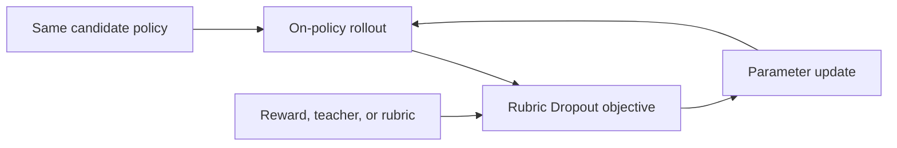
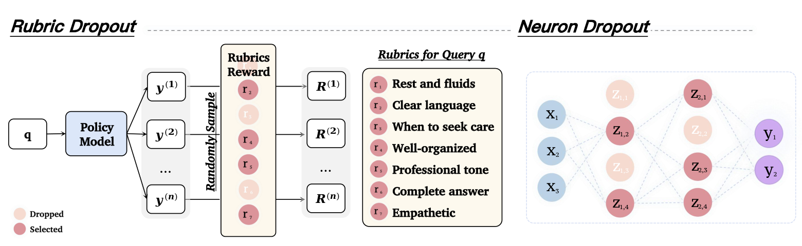

# Rubric Dropout: A Simple Way to Mitigate Reward Hacking in Rubric-as-Reward RL

<!-- source-sha256: 6336adf07eb694f13b58e23d30476814ecf920c7a1145b682a7c41c6ac86d324 -->

[简体中文](README.md)

> **Core-objective candidate-policy mini-suite.** Executes the paper-specific advantage, distillation, or constraint update, not paper-scale large-model training.

## Paper information

| Field | Details |
|---|---|
| Paper | [arXiv 2608.11669](https://arxiv.org/abs/2608.11669) |
| Organization | Scale AI |
| First public release | 2026-08-12 (arXiv v1) |
| Authors' code | No public author code was found as of 2026-08-24. |
| Adapter / method | `rubric-dropout` |
| Local reproduction code | `src/auto_research/post_training/historical_b08_b09.py` |
| First author | Minglai Yang |

## Original paper

### Motivation and method

Each rollout group shares a randomly thinned rubric, preventing the policy from persistently exploiting a fixed judge proxy.



<!-- paper-figure:start -->
### Key figure from the paper

[](https://arxiv.org/html/2608.11669v1/final.png)

> **Figure 1:** Training flow and key optimization steps. From the [original paper](https://arxiv.org/abs/2608.11669); copyright remains with the authors.
<!-- paper-figure:end -->

### Core equation

$$
R_{drop}(y)=\sum_k m_kr_k(y),\quad m_k\sim Bernoulli(1-p)
$$

### Paper results

At 30–50% dropout, the OOD gold judge gives gains of 1–2 points on HealthBench-Hard and 6–7 on ResearchQA. These are paper results. Without an industrial A/B test, no online gains are inferred.

## Local reproduction

The same arithmetic-smoke candidate policy runs 120 updates. Accuracy changes from 0.1953 before training to 0.2812 afterward, or +0.0859. This before/after smoke run is not a matched comparison with other RL or OPD algorithms. See the [per-method metrics](metrics/arithmetic-smoke-seed42.json) and [batch index](../../experiments/historical-b07-b11-seed42.json).

```bash
auto-research post-train --algorithm rubric-dropout --dataset arithmetic-smoke --steps 120 --seed 42 --no-network
```

## Reproduction boundaries

An auditable candidate policy exercises the core objective and diagnostics. No large checkpoint was downloaded, and the full data, compute, seeds, or benchmark are not reproduced. Raw results default to runs/post-training/; only metrics are committed, not checkpoints. See [experiments](../../experiments/).
