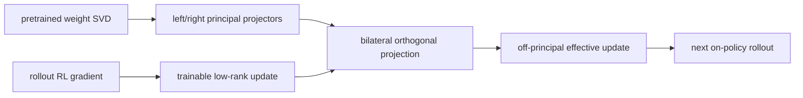
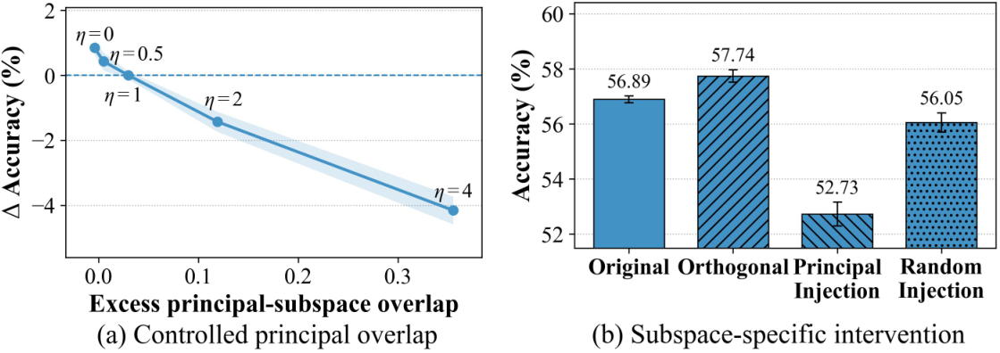

# GCPO: Stabilizing Rollout RL with Bilateral Orthogonal Constraints

<!-- source-sha256: 8e7327f70696e7d36010f00618bc1d5a0ccfe24a5f7299041eb8a3beac74332d -->

[简体中文](README.md)

> **Reproduction level: core-mechanism mini-suite.** Measures rollout-update overlap with the principal subspace and projects policy updates onto its complement. A linear policy is not full bilateral LoRA for matrix layers.

## Paper information

| Field | Details |
|---|---|
| Paper | [arXiv 2608.11674](https://arxiv.org/abs/2608.11674) |
| Organization | Shanghai AI Laboratory |
| First public release | 2026-08-12 (arXiv v1) |
| Authors' code | [Released: Icarus1411/GCPO](https://github.com/Icarus1411/GCPO). |
| Adapter / method | `gcpo` |
| Local reproduction code | [`src/auto_research/post_training/latest_20260824.py`](https://github.com/daiwk/auto-research/blob/main/src/auto_research/post_training/latest_20260824.py) |

## Original paper

### Motivation and method

On-policy rollout RL such as GRPO may enter the principal singular subspaces of pretrained weights. The paper observes spikes often before validation regressions. GCPO fixes the top-k singular spaces on both sides and restricts low-rank updates to their input and output orthogonal complements. This is a hard feasible set, not a soft penalty with a tuned coefficient.



<!-- paper-figure:start -->
### Key figure from the paper

[](https://arxiv.org/html/2608.11674v1/principal_intervention_combined.png)

> **Figure 2:** Overall design and key components. From the [original paper](https://arxiv.org/abs/2608.11674); copyright remains with the authors.
<!-- paper-figure:end -->

### Core equation

$$
\delta W=\Pi_\Phi^\perp\delta W\Pi_\Psi^\perp,
\qquad
\delta W=\alpha\Pi_\Phi^\perp LR\Pi_\Psi^\perp.
$$

Thus $\Phi_k^\top\delta W=0$ and $\delta W\Psi_k=0$, so rollout updates do not overwrite the principal mapping.

### Paper results

On Qwen3-8B and GLM4-9B math, code, and tool tasks, GCPO gains up to 27.69 points over the base and 2.37 over the strongest baseline. MATH500 scores 74.56 with the bilateral hard constraint versus 72.34 unconstrained. There is no industrial online A/B.

## Local reproduction

> **Local comparison.** The same randomly initialized candidate policy before training and after 120 projected GCPO updates. Accuracy increases 0.1953 to 0.6328 (**+224.00%**), a before/after change, not a matched comparison showing superiority to GRPO.

The last step removes principal overlap 0.9956 and has projected gradient norm 0.0351. See [stable metrics](metrics/arithmetic-smoke-seed42.json) and [batch index](../../experiments/recent-papers-20260824-seed42.json).

```bash
auto-research post-train --algorithm gcpo --dataset arithmetic-smoke --steps 120 --seed 42
```

## Limits

Local policy parameters are vectors; the operator uses the principal right singular space of empirical update covariance for an analogous orthogonal constraint. It does not reproduce per-layer bilateral matrix LoRA for Qwen3-8B/GLM4-9B, three seeds, or paper benchmarks.
