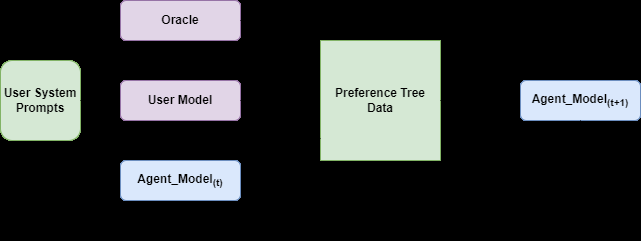

<!-- source-sha256: 223f6343bccba8f8de6e0a42ec10fd8a955fbf3a55a126c40897edeb33251c24 -->

[简体中文](README.md) · English

# Preference Tree Optimization: Simulating continuations for long-term preferences

> **Core mechanism mini-suite.** Constructs a preference tree, runs oracle ranking and computes lookahead advantages. This is not the paper's counseling-model experiment.

## Paper information

| Field | Details |
| --- | --- |
| Paper | [arXiv 2608.12062](https://arxiv.org/abs/2608.12062) |
| Institution | Reichman University |
| First public release | 2026-08-12 (arXiv v1) |
| Author code | No public author code found on 2026-08-13. |
| Local adapter or method key | `pto` |
| Local reproduction code | [`src/auto_research/post_training/latest_20260813.py`](https://github.com/daiwk/auto-research/blob/main/src/auto_research/post_training/latest_20260813.py) |

## Original paper summary

### Background and main changes

Turn-by-turn preferences rate only the current answer and miss long-term goals. PTO expands candidate dialogue trees with an agent and simulated user. An oracle scores both current responses and continuations; preference pairs train DPO iteratively. Deeper lookahead makes the long-term policy more stable.


<!-- paper-figure:start -->
### Key figure from the paper

[](https://arxiv.org/html/2608.12062v1/fig_framework.png)

> **Figure 1:** Core architecture, modules and connections. From the [paper](https://arxiv.org/abs/2608.12062); copyright belongs to the authors. Click for the source.
<!-- paper-figure:end -->

### Core equations

$$
r^{LA}(a_t)=r(a_t)+\gamma\max_{a_{t+1:t+K}}R(\tau),\qquad
\mathcal L_{PTO}=\mathcal L_{DPO}(y_w,y_l\mid h_t).
$$

### Offline and online results

The Llama-2-7B baseline Final Score is 3.453. The best model, at lookahead depth 5, reaches 3.982, with Session Satisfaction 4.190 and Working Alliance 3.775. This is offline simulated counseling evaluation, not industrial A/B.

## Local reproduction

After 120 steps in the arithmetic mini-suite, accuracy rises from 0.1953 to 0.4453. The final step records 12 tree nodes, 6 oracle comparisons and lookahead depth 1. This one-seed task verifies the optimization operator only.

```bash
auto-research post-train --algorithm pto --dataset arithmetic-smoke --steps 120 --seed 42
```

See [stable metrics](metrics/arithmetic-smoke-seed42.json). The [cross-topic index](../../experiments/mr7-latest-20260813-seed42.json) links each paper's metrics without duplicating values.

## Scope

No Llama-2-7B, simulated counseling patient or LLM oracle was run. Deterministic rewards replace only the costly evaluator; preference trees and lookahead credit execute.
