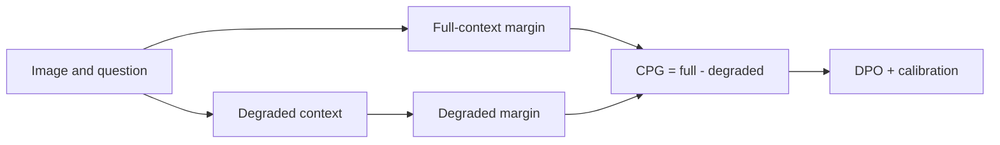
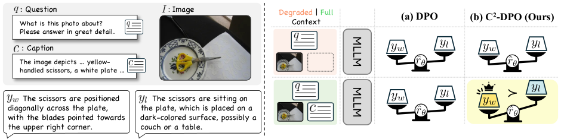

<!-- source-sha256: 15d35504b6ea7277211b0d3e181d4b729dbf2f142509a473c54383504749863a -->

[简体中文](README.md) · English

# C²-DPO: Reducing multimodal hallucinations with contextual preference gain

> **Fidelity: core-mechanism mini-suite.** Computes Contextual Preference Gain between full and degraded context and uses it in preference updates. The candidate policy is not a full MLLM fine-tuning run.

## Paper information

| Field | Details |
| --- | --- |
| Paper | [arXiv 2608.12158](https://arxiv.org/abs/2608.12158) |
| Institution | Korea University (first-listed affiliation of the first author; collaboration with KAIST) |
| First public release | 2026-08-12 (arXiv v1) |
| Author code | [Released: mlvlab/C2-DPO](https://github.com/mlvlab/C2-DPO) |
| Local adapter or method key | `c2-dpo` |
| Local reproduction code | [`src/auto_research/post_training/latest_20260813.py`](https://github.com/daiwk/auto-research/blob/main/src/auto_research/post_training/latest_20260813.py) |

## Original paper summary

### Background and main changes

Standard DPO can rely mostly on language priors even when given relevant image context. The paper defines CPG as the increase in the chosen-versus-rejected preference margin when context is added. C²-DPO increases that gain directly while retaining the original preference ordering.



<!-- paper-figure:start -->
### Key figure from the paper

[](https://arxiv.org/html/2608.12158v1/figure1_motivation.png)

> **Figure 1:** Overall design and components. From the [paper](https://arxiv.org/abs/2608.12158); copyright belongs to the authors. Click for the source.
<!-- paper-figure:end -->

### Core equations

$$
\operatorname{CPG}=\Delta_\theta(y_w,y_l\mid x,c)-\Delta_\theta(y_w,y_l\mid x,\tilde c),\qquad
\mathcal L_{C^2\text{-DPO}}=\mathcal L_{DPO}-\lambda\operatorname{CPG}.
$$

### Offline and online results

On Object HalBench, Qwen2-VL-Instruct-2B reaches response-level hallucination of 1.6, a **36%** reduction against C-DPO, and mention-level hallucination of 1.0 (60% lower). Its AMBER hallucination score is 16.1, without a loss in general multimodal reasoning. The paper reports public benchmarks but no industrial online A/B test.

## Local reproduction

On the 120-step arithmetic mini-suite, accuracy goes from 0.1953 to 0.6719; the final-step CPG is 0.05844 with 2 preference pairs. This shows that the calibration gradient executes, not that Object HalBench was reproduced.

```bash
auto-research post-train --algorithm c2-dpo --dataset arithmetic-smoke --steps 120 --seed 42
```

Stable metrics: [`metrics/arithmetic-smoke-seed42.json`](metrics/arithmetic-smoke-seed42.json). The [cross-domain batch index](../../experiments/mr7-latest-20260813-seed42.json) points to each paper's own metrics and does not duplicate their values.

## Scope

Qwen2-VL, SENTINEL, and Object HalBench have not been downloaded for full fine-tuning. MR7 also adds checkpoint-matrix and lmms-eval infrastructure that could support integrating this objective into real MLLM training.
