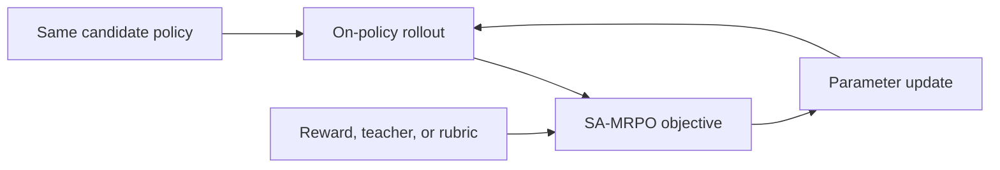
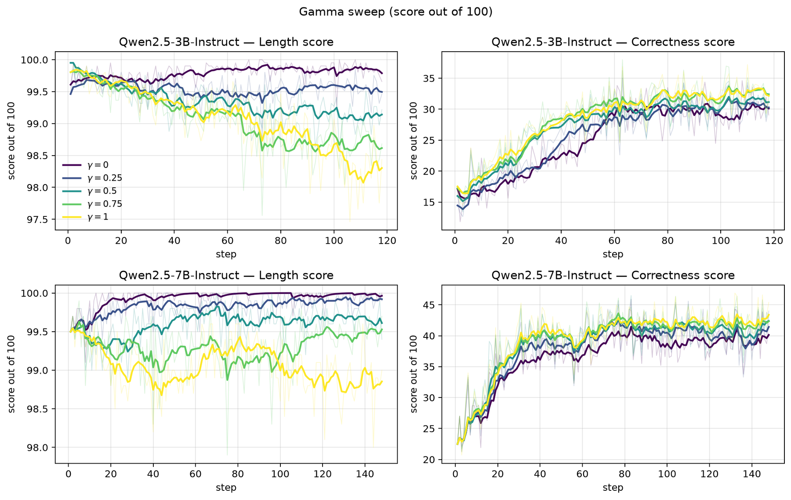

# Learn What's Left, Not What's Mastered: Saturation Aware Advantage Reweighting for Multi-Reward Policy Optimization

<!-- source-sha256: f6b76ead832626465422575a53322666d3d1da9827881a961f86b3af0738bec5 -->

[简体中文](README.md)

> **Core-objective candidate-policy mini-suite.** Executes the paper-specific advantage, distillation, or constraint update, not paper-scale large-model training.

## Paper information

| Field | Details |
|---|---|
| Paper | [arXiv 2608.16072](https://arxiv.org/abs/2608.16072) |
| Organization | University of Florida |
| First public release | 2026-08-17 (arXiv v1) |
| Authors' code | No public author code was found as of 2026-08-24. |
| Adapter / method | `sa-mrpo` |
| Local reproduction code | `src/auto_research/post_training/historical_b08_b09.py` |
| First author | Yixuan Wang |

## Original paper

### Motivation and method

Normalize advantages per reward dimension and shift gradient budget toward unmastered objectives according to batch saturation.



<!-- paper-figure:start -->
### Key figure from the paper

[](https://arxiv.org/html/2608.16072v1/gamma_sweep_smooth.png)

> **Figure 2:** Training flow and key optimization steps. From the [original paper](https://arxiv.org/abs/2608.16072); copyright remains with the authors.
<!-- paper-figure:end -->

### Core equation

$$
A=\sum_k(1-s_k)\frac{r_k-\mu_k}{\sigma_k+\epsilon}
$$

### Paper results

Hard-example accuracy wins 12 of 15 comparisons. AIME24 improves up to +5% and AMC23 +9.2%. These are paper results. Without an industrial A/B test, no online gains are inferred.

## Local reproduction

The same arithmetic-smoke candidate policy runs 120 updates. Accuracy changes from 0.1953 before training to 0.2812 afterward, or +0.0859. This before/after smoke run is not a matched comparison with other RL or OPD algorithms. See the [per-method metrics](metrics/arithmetic-smoke-seed42.json) and [batch index](../../experiments/historical-b07-b11-seed42.json).

```bash
auto-research post-train --algorithm sa-mrpo --dataset arithmetic-smoke --steps 120 --seed 42 --no-network
```

## Reproduction boundaries

An auditable candidate policy exercises the core objective and diagnostics. No large checkpoint was downloaded, and the full data, compute, seeds, or benchmark are not reproduced. Raw results default to runs/post-training/; only metrics are committed, not checkpoints. See [experiments](../../experiments/).
