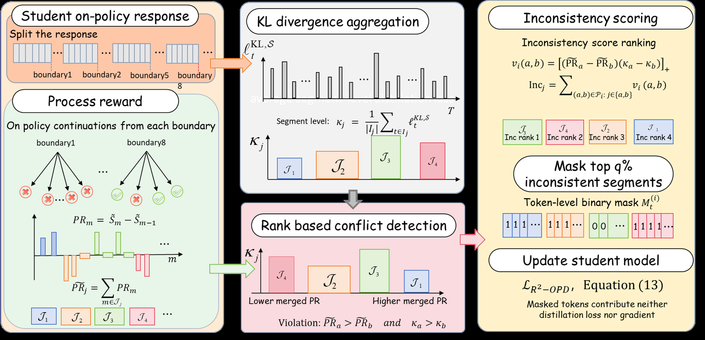

# Beyond Imitation: Filtering On-Policy Distillation by Reasoning Progress

<!-- source-sha256: 3b0285ecf6640ec6f6ac8baf1acdcb140dd979340448b5e942ed62a84be8ba67 -->

[简体中文](README.md)

> Core candidate-policy objective.

## Paper information

| Field | Details |
|---|---|
| Paper | [Paper or original source](https://arxiv.org/abs/2608.19408) |
| Institution | No affiliation disclosed; first author Chen Yang. |
| First public release | 2026-08-19 (arXiv v1) |
| Author code | No public author code found as of 2026-08-24. |
| Local adapter or method key | `r2-opd` |
| Local reproduction code | `src/auto_research/post_training/historical_b08_b09.py` |

## Paper method and evidence

Rank reasoning spans by teacher reward and an independent progress reward. Mask distillation where those rankings conflict.


<!-- paper-figure:start -->
### Original paper figure

[](https://arxiv.org/html/2608.19408v1/Figures/reasoning_progress_aware_reward_filtering_for_OPD.png)

The original figure shows reasoning-progress filtering. From the [original paper](https://arxiv.org/abs/2608.19408); copyright remains with the authors.
<!-- paper-figure:end -->

### Core equation

$$
A_i^{R^2}=A_i^{OPD}\mathbf1[\operatorname{rank}(r_i^T)=\operatorname{rank}(r_i^P)]
$$

### Reported results

The paper reports consistent gains over standard OPD, especially on harder reasoning tasks.

## Local reproduction

120 updates: **0.1953→0.6641 (+0.4688)**. [Arithmetic metrics](metrics/arithmetic-smoke-seed42.json) and [batch index](../../experiments/historical-b07-b11-seed42.json). Before/after on one candidate policy is not a fair comparison with other methods. No author checkpoints, full data/compute, multiple seeds, or benchmark; `runs/post-training/` stays local and [experiment artifacts](../../experiments/) retain metrics only.

```bash
auto-research post-train --algorithm r2-opd --dataset arithmetic-smoke --steps 120 --seed 42 --no-network
```
