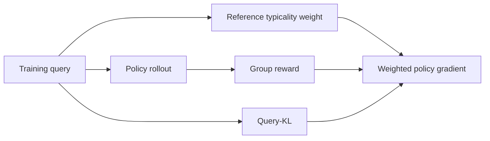
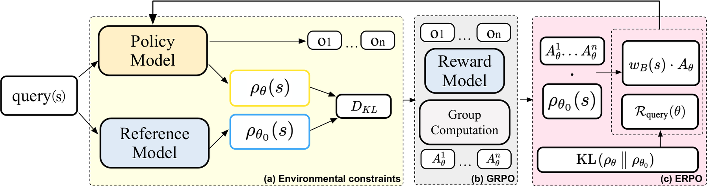

<!-- source-sha256: 5f3ce36ee0e2ebc4e21d39356e448be1558545dbe156f5bbd3eff62d0d9b0943 -->

[简体中文](README.md) · English

# ERPO: Constraining policy drift on the query side

> **Candidate-policy core mechanism.** Reference typicality weighting and Query-KL actually run; response-side Policy-KL weight is zero.

## Paper information

| Field | Details |
| --- | --- |
| Paper | [arXiv 2608.23311](https://arxiv.org/abs/2608.23311) |
| Institution | Amap / Alibaba Group (first listed affiliation of the first author) |
| First public release | 2026-08-24 (arXiv v1) |
| Author code | Yes: [alibaba/ERPO](https://github.com/alibaba/ERPO). |
| Local adapter or method key | `erpo` |
| Local reproduction code | [`src/auto_research/post_training/latest_20260825.py`](https://github.com/daiwk/auto-research/blob/main/src/auto_research/post_training/latest_20260825.py) |

## Original paper summary

### Background and main changes

Policy-KL constrains responses directly and consumes exploration budget to stabilize training. ERPO observes that the induced query distribution also drifts during RL, so it puts regularization on the input side. Frozen-reference query likelihood gives static query weights; Query-KL controls environment-distribution drift without directly constraining the response score function.



<!-- paper-figure:start -->
### Key figure from the paper

[](https://arxiv.org/html/2608.23311v1/main_pipeline_final.png)

> **Figure 2:** Overall design and components. From the [paper](https://arxiv.org/abs/2608.23311); copyright belongs to the authors. Click for the source.
<!-- paper-figure:end -->

### Core equations

$$
\mathcal R_{query}(\theta)=\mathrm{KL}(\rho_\theta\|\rho_{\theta_0}),\qquad
w^*(q)=\frac{\rho_{\theta_0}(q)}{\rho_{train}(q)},
$$

$$
\mathcal L_{ERPO}=-\mathbb E[w(q)g(q,o)]+\alpha\mathcal R_{query}(\theta).
$$

### Offline and online results

Across six math reasoning benchmarks, replacing Policy-KL improves accuracy and long-horizon stability, particularly by controlling query drift at high sampling temperatures. No industrial A/B.

## Local reproduction

Same initial candidate policy, arithmetic-smoke, 100 steps, seed 42. Baseline accuracy **0.1953**, ERPO **0.6094** (+212.0%). Final Query-KL **0.00566** and response Policy-KL coefficient **0**. See [metrics](metrics/arithmetic-smoke-seed42.json) and [batch index](../../experiments/latest-20260825-seed42.json).

```bash
auto-research post-train --algorithm erpo --dataset arithmetic-smoke --steps 100 --seed 42
```

## Scope

Candidate typicality proxies query likelihood to check gradient boundaries and stability control flow. No real LLM or rerun of six paper benchmarks.
