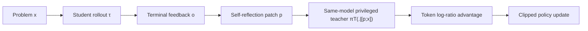
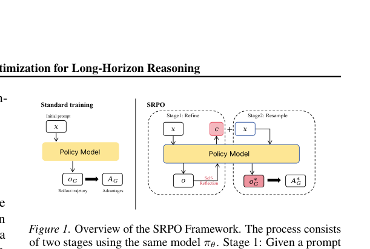

<!-- source-sha256: c816df33f1470f4b594d86f9e4fcd4632acdf046caa057ca39061a5fd909d051 -->

[简体中文](README.md) · English

# SRPO: Turning terminal reward into token-level credit through self-reflection

> **Fidelity: core mechanism on a candidate policy.** Runs reflection patches, reflection-conditioned teacher scores, and dense advantages. The small proxy policy is not Qwen3-8B training.

## Paper information

| Field | Details |
| --- | --- |
| Paper | [arXiv 2608.23493](https://arxiv.org/abs/2608.23493) |
| Institution | Wuhan University (first-listed affiliation of the first author) |
| First public release | 2026-08-24 (arXiv v1) |
| Author code | [Released: Galleons2029/SRPO](https://github.com/Galleons2029/SRPO) |
| Local adapter or method key | `srpo` |
| Local reproduction code | [`src/auto_research/post_training/latest_20260825.py`](https://github.com/daiwk/auto-research/blob/main/src/auto_research/post_training/latest_20260825.py) |

## Original paper summary

### Background and main changes

When a long trajectory only receives a terminal reward, it is hard to identify which token or action caused a failure. SRPO asks the current model to write a short reflection patch from the complete trajectory and environment outcome, then adds that patch to the original prompt. The same model acts as a teacher with this privileged context and gives per-token scores to the student's on-policy rollout.



<!-- paper-figure:start -->
### Key figure from the paper

[](https://arxiv.org/pdf/2608.23493#page=3)

> **Figure 1:** The core architecture, its main modules, and their connections. From the [paper](https://arxiv.org/abs/2608.23493); copyright belongs to the authors. Click for the source.
<!-- paper-figure:end -->

### Core equations

$$
p=\operatorname{Reflect}_{\pi_\theta}(x,\tau,o),\qquad
\pi_T(\cdot\mid x)=\pi_\theta(\cdot\mid[p;x]),
$$

$$
r_t=\operatorname{sg}\!\left[\log\pi_T(a_t\mid s_t)-
\log\pi_{\theta_{old}}(a_t\mid s_t)\right],\quad
A_t=r_t-\frac{1}{|\mathcal V|}\sum_{j\in\mathcal V}r_j.
$$

### Offline and online results

Qwen3-8B scores **73.3%** on AIME'24 at **0.08×** the training FLOPs of scaled SFT. WebShop, ALFWorld, and SWE-Bench-Lite results are **64.7% / 76.8% / 31.2%**, respectively. No industrial online A/B test is reported.

## Local reproduction

The run uses the same initial candidate policy, arithmetic-smoke with 512 training and 128 validation examples, 100 steps, and seed 42. Accuracy is **0.1953** for the untrained baseline and **0.5703** for SRPO (+192.0%). The final batch yields 3 nonzero reflection patches. See [`metrics/arithmetic-smoke-seed42.json`](metrics/arithmetic-smoke-seed42.json) and the [batch index](../../experiments/latest-20260825-seed42.json).

```bash
auto-research post-train --algorithm srpo --dataset arithmetic-smoke --steps 100 --seed 42
```

## Scope

The local proxy policy uses outcome/process rewards to construct dense reflection credit in the same direction. It does not run Qwen3-8B, WebShop, ALFWorld, SWE-Bench, or real token rollouts.
