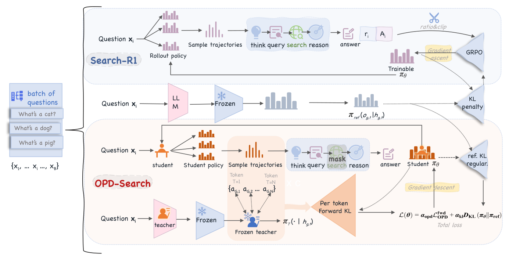

<!-- source-sha256: 3cef83cddd911953f89c2f70b771bc38d34104b2974c1e46425092b1828abbc3 -->

[简体中文](README.md) · English

# OPDSearch+: Distilling a frozen general teacher before search RL

> **Candidate-policy core mechanism.** Clipped forward KL and subsequent verifier RL both run. The Qwen2.5-3B search agent was not trained.

## Paper information

| Field | Details |
|---|---|
| Paper | [arXiv 2608.24310](https://arxiv.org/abs/2608.24310) |
| Institution | University of Chinese Academy of Sciences (first listed affiliation of the first author) |
| First public release | 2026-08-25 (arXiv v1) |
| Author code | No public code found on 2026-08-26. |
| Local adapter/method | `opd-search-plus` |
| Local reproduction code | [`src/auto_research/post_training/latest_20260826.py`](https://github.com/daiwk/auto-research/blob/main/src/auto_research/post_training/latest_20260826.py) |

## Original paper summary

### Background and main changes

Multi-turn search SFT data is costly, and a domain teacher needs training first. OPDSearch+ freezes a general instruct teacher and uses forward KL to distill query, reasoning and answer tokens on the student's online search trajectories. Verifier RL then starts from the better behavior distribution, aiming to move beyond the teacher and the local optima of RL alone.


<!-- paper-figure:start -->
### Key figure from the paper

[](https://arxiv.org/html/2608.24310v1/fig_overview.png)

> **Figure 2:** Core architecture, modules and connections. From the [paper](https://arxiv.org/abs/2608.24310); copyright belongs to the authors. Click for the source.
<!-- paper-figure:end -->

### Core equation

$$
r_t=\frac{\pi_T(o_t\mid o_{<t})}{\pi_\theta(o_t\mid o_{<t})},\quad
\nabla\mathcal L_{OPD}=-\frac1{|\mathcal M|}\sum_t\operatorname{clip}(r_t,\epsilon,R_{max})\nabla\log\pi_\theta(o_t).
$$

### Offline and online results

The 3B student averages **0.4402** EM over seven QA benchmarks versus **0.421** for the previous best 3B RL approach; HotpotQA and 2Wiki gains are **13.1% / 8.5%**, respectively. No industrial online A/B.

## Local reproduction

On arithmetic-smoke, 100 steps and seed 42, accuracy was **0.1953 → 0.6641**. This single seed shows both objectives run, not a stable gain. See [metrics](metrics/arithmetic-smoke-seed42.json) and the [batch index](../../experiments/latest-20260826-seed42.json).

```bash
auto-research post-train --algorithm opd-search-plus --dataset arithmetic-smoke --steps 100 --seed 42
```

## Scope

Candidate-level process signals replace actual query/reasoning/answer tokens and search-engine feedback. The 3B/14B models, Wikipedia index and seven QA benchmarks were not run.
