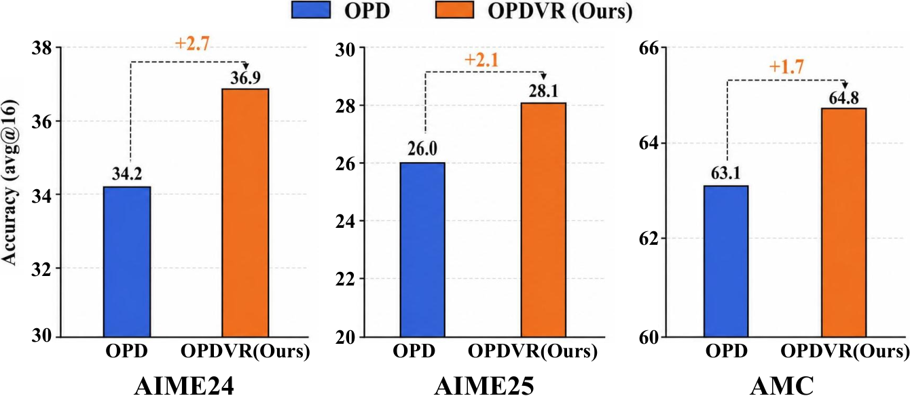

# OPDVR: Use verifiable rewards to correct implicit OPD reward signs

<!-- source-sha256: 37091512d2b40baa8562fa75714415f27fb562dcccb75796e47c8d84ce00a86f -->

[简体中文](README.md)

> Candidate-policy sampled-token reward and correctness-aware ReLU gate.

## Paper information

| Field | Details |
|---|---|
| Paper | [Paper or original source](https://arxiv.org/abs/2608.24696) |
| Institution | LeapLab, Tsinghua University (first-listed first-author affiliation). |
| First public release | 2026-08-25 (arXiv v1) |
| Author code | [LeapLabTHU/OPDVR](https://github.com/LeapLabTHU/OPDVR). |
| Local adapter or method key | `opdvr` |
| Local reproduction code | [`src/auto_research/post_training/latest_20260826.py`](https://github.com/daiwk/auto-research/blob/main/src/auto_research/post_training/latest_20260826.py) |

## Paper method and evidence

Sampled-token teacher/student ratios can penalize correct trajectories or reward wrong ones. Rather than adding a separate RL loss, gate the existing implicit reward with verifier correctness: retain nonnegative signals for correct traces and nonpositive signals for incorrect traces.


<!-- paper-figure:start -->
### Original paper figure

[](https://arxiv.org/html/2608.24696v1/OPD-OPDVR-acc.png)

The original figure shows the sign gate. From the [original paper](https://arxiv.org/abs/2608.24696); copyright remains with the authors.
<!-- paper-figure:end -->

### Core equation

$$
R_{OPD}(o_t)=\log\frac{\pi_T(o_t\mid q,o_{<t})}{\pi_\theta(o_t\mid q,o_{<t})},
$$

$$
R_{OPDVR}=\mathbf1[y=1]\operatorname{ReLU}(R_{OPD})-\mathbf1[y=0]\operatorname{ReLU}(-R_{OPD}).
$$

### Reported results

Matched Qwen3-4B six-benchmark average **47.8→49.1** over sampled-token OPD; AIME24 **36.9**. No industrial A/B.

## Local reproduction

Arithmetic-smoke, 100 steps, seed 42: **0.1953→0.6641**, final reference KL **0.0018**. [Metrics](metrics/arithmetic-smoke-seed42.json), [batch index](../../experiments/latest-20260826-seed42.json). Candidates and exact outcomes proxy token rollouts; no Qwen3, six benchmarks or actual verifier rollout.

```bash
auto-research post-train --algorithm opdvr --dataset arithmetic-smoke --steps 100 --seed 42
```
