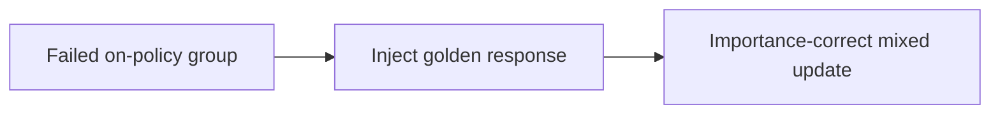
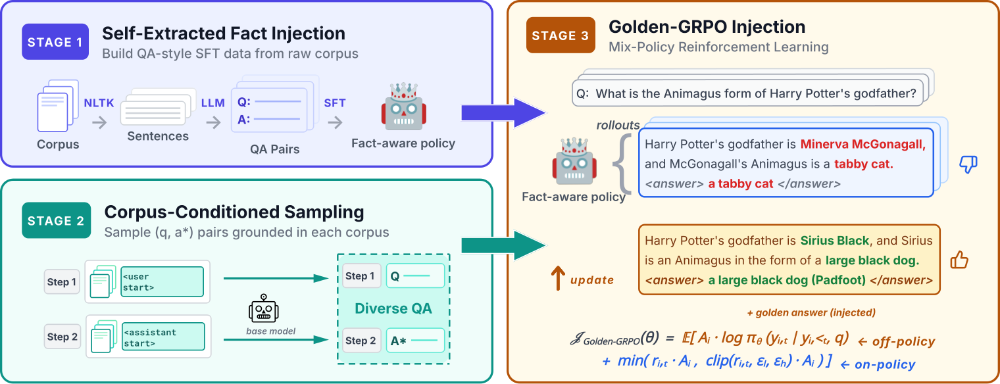

# GRIN: Continual knowledge uptake through mixed-policy RL

<!-- source-sha256: 0361471c3d4541872268b5b8dbd133755bc6e83401fe96c11e0b4f84b64b704c -->

[简体中文](README.md)

> Core candidate mini-suite, not paper-scale continual training.

## Paper information

| Field | Details |
|---|---|
| Paper | [Paper or original source](https://arxiv.org/abs/2608.25243) |
| Institution | University of California, Merced (first author). |
| First public release | 2026-08-26 (arXiv v1) |
| Author code | No public author code found as of 2026-08-28. |
| Local adapter or method key | `grin` |
| Local reproduction code | [`src/auto_research/post_training/latest_20260827.py`](https://github.com/daiwk/auto-research/blob/main/src/auto_research/post_training/latest_20260827.py) |

## Paper method and evidence

When on-policy sampling rarely finds new correct answers, inject golden responses into failing groups and train with mixed-policy importance correction. Return to on-policy exploration when performance improves.



<!-- paper-figure:start -->
### Original paper figure

[](https://arxiv.org/html/2608.25243v1/bi8Au_arrow_border.png)

Figure shows gold injection and mixed-policy updates. From the [original paper](https://arxiv.org/abs/2608.25243); copyright remains with the authors.
<!-- paper-figure:end -->

### Core equation

$$
A(y)=\rho(y)\,[R(y)-b],\qquad \rho(y)=\frac{\pi_\theta(y|x)}{q_{mix}(y|x)}.
$$

### Reported results

Llama3.2-3B COUNTER mean accuracy **43.65%**, fail@k **24.05%**, outperforming SFT and mixed-policy baselines. No industrial A/B.

## Local reproduction

```bash
auto-research post-train --algorithm grin --dataset arithmetic-smoke --steps 100 --seed 42 --offline
```

Arithmetic-smoke 100 steps **0.1250→0.3438 (+175.00%)**; gold is a local candidate oracle, not a capability claim. [Metrics](metrics/grin-arithmetic-smoke-seed42.json), [batch index](../../experiments/latest-20260827-seed42.json). No paper checkpoint, private data, service or benchmark.
