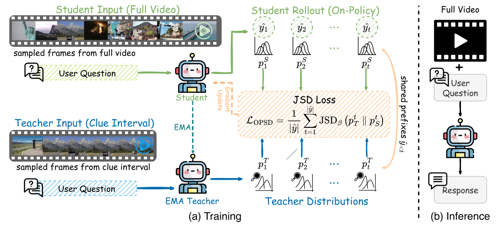

# Clue-OPSD: privileged-view distillation from long-video clues

<!-- source-sha256: 6439507a9212e2d956327edfbf96e75d1923021afd0bf659257e5e7204a6271b -->

[简体中文](README.md)

> **Core-mechanism mini-suite.** Executes the defining control flow and objective. Deterministic task success does not reproduce the paper's benchmarks.

## Paper information

| Field | Details |
|---|---|
| Paper | [arXiv 2608.25356](https://arxiv.org/abs/2608.25356) |
| Organization | University of Maryland, College Park / Johns Hopkins University (first author's first affiliation in the source) |
| First public release | 2026-08-26 (arXiv v1) |
| Authors' code | No public author code was found on 2026-08-28. |
| Adapter / method | `clue-opsd` |
| Local reproduction code | [`src/auto_research/post_training/latest_20260827.py`](https://github.com/daiwk/auto-research/blob/main/src/auto_research/post_training/latest_20260827.py) |

## Original paper

### Motivation and method

The student sees the full long video. During training a frozen teacher sees only the question-relevant clue interval. On-policy self-distillation uses the student's own rollouts; inference needs no clues, labels, or external teacher.


<!-- paper-figure:start -->
### Key figure from the paper

[](https://arxiv.org/html/2608.25356v1/figure2_overall.png)

> **Figure 2:** Overall workflow, stages, and data flow. From the [original paper](https://arxiv.org/abs/2608.25356); copyright remains with the authors.
<!-- paper-figure:end -->

### Core equation

$$
\mathcal L_{OPSD}=\mathbb E_{y\sim\pi_\theta(\cdot|v,q)}\sum_t D_{KL}(\pi_T(\cdot|c,q,y_{<t})\Vert\pi_\theta(\cdot|v,q,y_{<t})).
$$

### Paper results

Qwen3.5-2B improves **6.94/3.45/9.81/3.41 points** on MLVU/LVBench/LongVideoBench/MMVU, respectively. No industrial online A/B is reported.

## Local reproduction

> **Local comparison:** Arithmetic-smoke at 100 steps raises accuracy **0.1250 → 0.5938 (+375.00%)**; a process-reward proxy substitutes for clues.

See the [metrics](metrics/clue-opsd-arithmetic-smoke-seed42.json) and [batch index](../../experiments/latest-20260827-seed42.json).

```bash
auto-research post-train --algorithm clue-opsd --dataset arithmetic-smoke --steps 100 --seed 42 --offline
```

## Reproduction boundaries

The public deterministic candidate/plan tasks isolate the mechanism. The paper checkpoint, private training data, external services, and full benchmarks are not reproduced.
