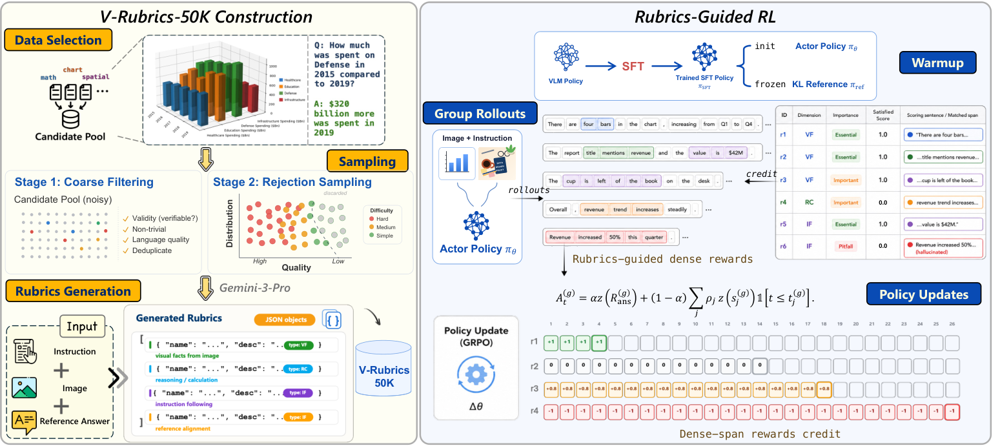

# V-Rubrics: Local credit from multidimensional visual rubrics

<!-- source-sha256: 5df351d8f4c301ffc56bbda74708e4236e03600d92be72371372e0ba28d3eee0 -->

[简体中文](README.md)

> Deterministic mechanism mini-suite; not paper benchmark reproduction.

## Paper information

| Field | Details |
|---|---|
| Paper | [arXiv 2608.25580](https://arxiv.org/abs/2608.25580) |
| Institution | S-Lab, Nanyang Technological University (first-listed first-author affiliation). |
| First public release | 2026-08-26 (arXiv v1) |
| Author code | [Author project](https://shulin16.github.io/v-rubrics/). |
| Local adapter or method key | `v-rubrics` |
| Local reproduction code | [`src/auto_research/post_training/latest_20260827.py`](https://github.com/daiwk/auto-research/blob/main/src/auto_research/post_training/latest_20260827.py) |

## Paper method and evidence

Decompose a reference answer into atomic rubric criteria for visual fidelity, reasoning consistency and instruction following. Attribute evidence to the relevant prefix so a terminal scalar does not hide local hallucinations.


<!-- paper-figure:start -->
### Original paper figure

[](https://arxiv.org/html/2608.25580v1/framework_overview.png)

The original figure shows localized rubric credit. From the [original paper](https://arxiv.org/abs/2608.25580); copyright remains with the authors.
<!-- paper-figure:end -->

### Core equation

$$
R=0.45R_{VF}+0.35R_{RC}+0.20R_{IF},\qquad A_i=R_i-\bar R.
$$

### Reported results

The authors report +1.79 average points over answer-only GRPO and +4.00 visual reasoning points over SFT. No industrial A/B.

## Local reproduction

```bash
auto-research post-train --algorithm v-rubrics --dataset arithmetic-smoke --steps 100 --seed 42 --offline
```

Arithmetic-smoke, 100 steps: accuracy **0.1250→0.2188 (+75.00%)**. Only multidimensional prefix-localized candidate credit is tested. [Metrics](metrics/v-rubrics-arithmetic-smoke-seed42.json), [batch index](../../experiments/latest-20260827-seed42.json). No original checkpoint, private data, external service or full benchmark.
