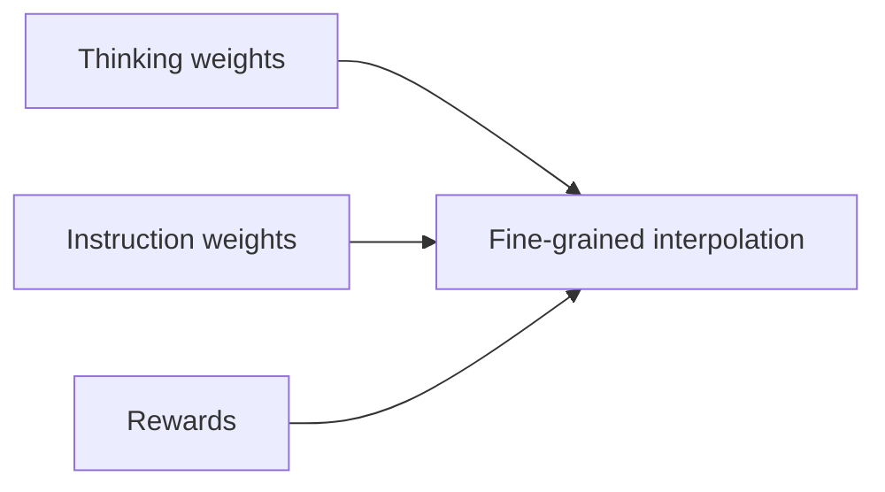
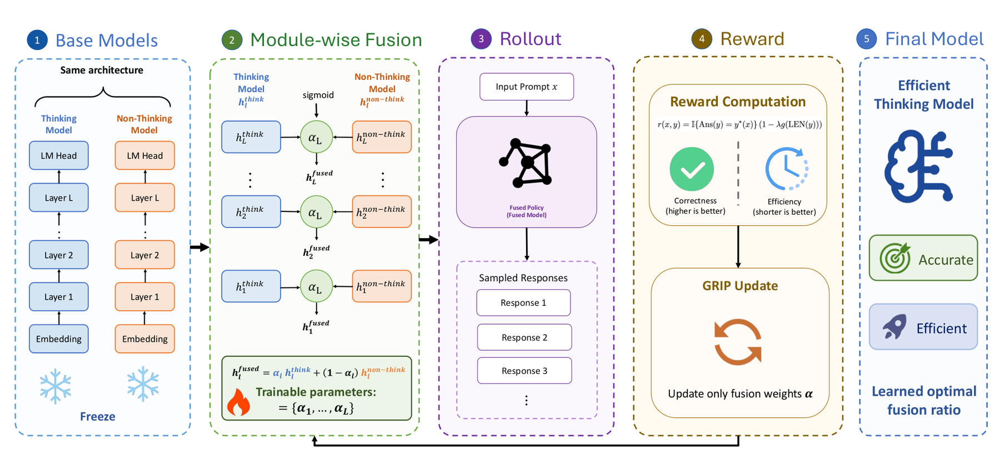

# GRIP: Parameter interpolation guided by fine-grained rewards

<!-- source-sha256: da1153a808d80d951235e812c747e40ea45b8255ff11fdabc77202a4b197ac9c -->

[简体中文](README.md)

> Deterministic mechanism diagnostic, not the original benchmark.

## Paper information

| Field | Details |
|---|---|
| Paper | [arXiv 2608.25583](https://arxiv.org/abs/2608.25583) |
| Institution | Peking University (first-listed first-author affiliation). |
| First public release | 2026-08-26 (arXiv v1) |
| Author code | The paper uses a public training framework, but no method-specific author repository was found as of 2026-08-28. |
| Local adapter or method key | `grip` |
| Local reproduction code | [`src/auto_research/post_training/latest_20260827.py`](https://github.com/daiwk/auto-research/blob/main/src/auto_research/post_training/latest_20260827.py) |

## Paper method and evidence

Replace a global blend between thinking and instruction weights with reward-driven layer/parameter interpolation to keep reasoning accuracy while shortening output.



<!-- paper-figure:start -->
### Original paper figure

[](https://arxiv.org/html/2608.25583v1/paper.png)

The original figure shows reward-driven interpolation. From the [original paper](https://arxiv.org/abs/2608.25583); copyright remains with the authors.
<!-- paper-figure:end -->

### Core equation

$$
\theta_{GRIP}=\alpha(r)\odot\theta_{think}+[1-\alpha(r)]\odot\theta_{inst}.
$$

### Reported results

The paper reports mean accuracy **76.5** across five reasoning benchmarks, matching or beating the thinking model at **73.0%** of its token usage. No industrial A/B.

## Local reproduction

```bash
auto-research post-train --algorithm grip --dataset arithmetic-smoke --steps 100 --seed 42 --offline
```

Arithmetic-smoke, 100 steps: **0.1250→0.2344 (+87.50%)**. Interpolate candidate policy probabilities, not LLM weights. [Metrics](metrics/grip-arithmetic-smoke-seed42.json), [batch index](../../experiments/latest-20260827-seed42.json). No original checkpoint, private data, external service, or full benchmark.
