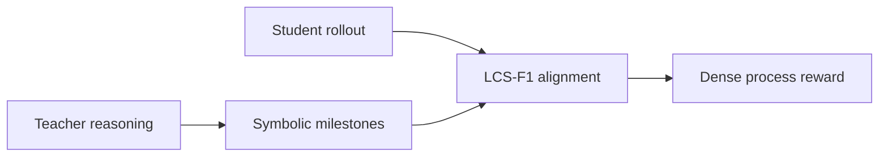
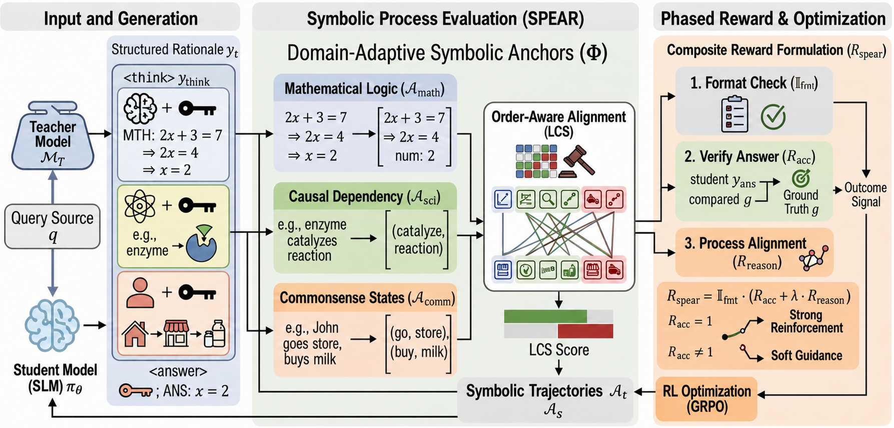

# SPEAR: Order-sensitive process rewards from symbolic reasoning skeletons

<!-- source-sha256: f0fa068aa97a0e54dff2750c47f973758349ab22ccc21822f4d56b0b97289755 -->

[简体中文](README.md)

> Core mechanism mini-suite: milestones, order alignment, and dense reward without a neural PRM.

## Paper information

| Field | Details |
|---|---|
| Paper | [arXiv 2608.26550](https://arxiv.org/abs/2608.26550) |
| Institution | University of Pittsburgh (first-listed affiliation of the first author). |
| First public release | 2026-08-27 (arXiv v1) |
| Author code | [zhuochunli/SPEAR](https://github.com/zhuochunli/SPEAR). |
| Local adapter or method key | `spear` |
| Local reproduction code | [`src/auto_research/post_training/latest_20260829.py`](https://github.com/daiwk/auto-research/blob/main/src/auto_research/post_training/latest_20260829.py) |

## Paper method and evidence

Outcome rewards are sparse and neural process reward models are expensive. Project teacher reasoning into domain-specific symbolic milestones and reward student traces with order-sensitive longest-common-subsequence F1.

<!-- paper-figure:start -->
### Original paper figure

Figure 2 shows milestone extraction and reward calculation. From the [original paper](https://arxiv.org/abs/2608.26550); copyright remains with the authors.
<!-- paper-figure:end -->

### Core equation

$$
R_{SPEAR}=\frac{2P_{LCS}R_{LCS}}{P_{LCS}+R_{LCS}}.
$$

### Reported results

The paper reports better student distillation on mathematical, scientific, and commonsense reasoning without an external neural verifier; no industrial A/B.

## Local reproduction

The 100-step arithmetic smoke test improved from **0.1953 to 0.2812** accuracy with zero neural PRM calls. [Metrics](metrics/arithmetic-smoke-seed42.json) and [batch results](../../experiments/latest-20260829-seed42.json). Local milestones use candidate process/format attributes, not the paper's natural-language symbolic extractor.
