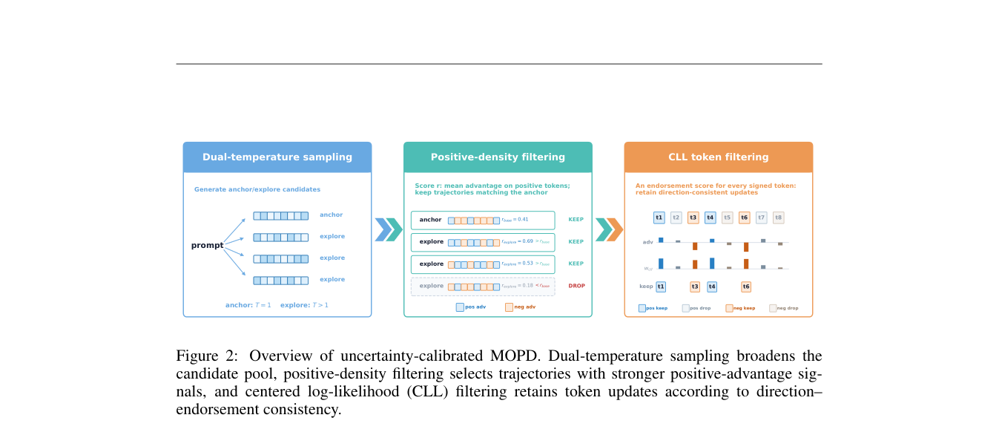

# Uncertainty-Calibrated MOPD: preserving general capability in multi-teacher distillation

<!-- source-sha256: 57d25dd7c1e4133ac6249cae85d0b319317cbc85fb9bbbf830eee32d497445af -->

[简体中文](README.md)

> **Core-mechanism mini-suite.** Implements two-temperature sampling, positive-advantage density selection, and centered log-likelihood gating.

## Paper information

| Field | Details |
|---|---|
| Paper | [arXiv 2608.26735](https://arxiv.org/abs/2608.26735) |
| Organization | Peking University, the first listed affiliation of the first author; work completed during a Kuaishou internship |
| First public release | 2026-08-27 (arXiv v1) |
| Authors' code | No public author code was found when checked on 2026-08-29. |
| Adapter / method | `uc-mopd` |
| Local reproduction code | [`src/auto_research/post_training/latest_20260829.py`](https://github.com/daiwk/auto-research/blob/main/src/auto_research/post_training/latest_20260829.py) |

## Original paper

### Motivation and method

Ordinary MOPD seldom samples tokens with strongly positive advantages and cannot tell whether update directions are reliable. This method broadens the sampling temperature range, selects trajectories by positive-advantage density, and uses entropy-calibrated CLL probabilities to gate token updates.

<!-- paper-figure:start -->
### Key figure from the paper

> **Figure 2:** Overview of the paper's method and key components. From the [original paper](https://arxiv.org/abs/2608.26735); copyright remains with the authors.
<!-- paper-figure:end -->

### Core equations

$$
q_i=\sigma(\log p_T(y_i)-\mathbb E_v\log p_T(v)),\quad m_i\sim\mathrm{Bernoulli}(q_i).
$$

### Paper results

In role-playing and medical specialization, general capability improves on average by **4.73% / 10.84%** relative to standard MOPD, while domain performance is retained.

## Local reproduction

Arithmetic-smoke accuracy is **0.1953 → 0.1953**. The zero gain is retained. A working mechanism on a single-teacher candidate suite cannot establish the paper's multi-teacher benefit.

See the [metrics](metrics/arithmetic-smoke-seed42.json) and [batch index](../../experiments/latest-20260829-seed42.json).

## Reproduction boundaries

No general or domain teacher checkpoints were loaded. Results verify only the filtering and stochastic-gating control flow.
