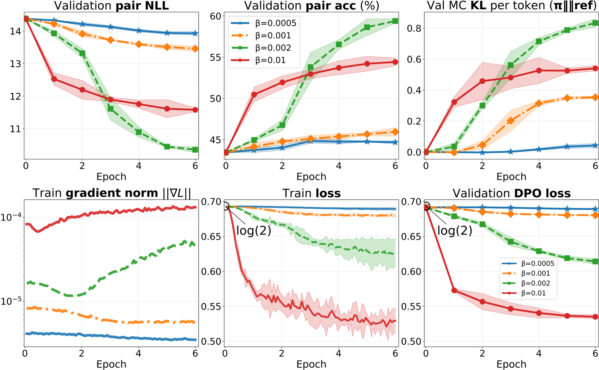

# Normalized DPO: Separate preference scale from optimization scale

<!-- source-sha256: 025c3c79ef5f26942f097ff169728d2f12b67aff9b4e6297634f2efefdeb756a -->

[简体中文](README.md)

> Formula mini-suite plus a bounded real causal-LM update; not full preference training.

## Paper information

| Field | Details |
|---|---|
| Paper | [Paper or original source](https://arxiv.org/abs/2608.27032) |
| Institution | Ivan Kruzhilov; no affiliation listed. |
| First public release | 2026-08-27 (arXiv v1) |
| Author code | [ivankru/bayesian_dpo](https://github.com/ivankru/bayesian_dpo). |
| Local adapter or method key | `normalized-dpo` |
| Local reproduction code | [`src/auto_research/post_training/latest_20260831.py`](https://github.com/daiwk/auto-research/blob/main/src/auto_research/post_training/latest_20260831.py) |

## Paper method and evidence

Standard DPO beta changes preference noise and gradient size simultaneously, implicitly scaling learning rate. Divide a centered softplus by beta to preserve the minimizer and keep nonvanishing gradient in the beta-to-zero limit.


<!-- paper-figure:start -->
### Original paper figure

[](https://arxiv.org/html/2608.27032v1/images/hsteer_4b_standard_lr2e4_epoch6_nll_kl_grad_seed_mean.png)

The original figure shows the normalized objective. From the [original paper](https://arxiv.org/abs/2608.27032); copyright remains with the authors.
<!-- paper-figure:end -->

### Core equation

$$
\ell_{NDPO}(m;\beta)=\frac{\operatorname{softplus}(-\beta m)-\log2}{\beta},\quad
\frac{\partial\ell}{\partial m}=-\sigma(-\beta m).
$$

### Reported results

No local accuracy gain is claimed.

## Local reproduction

Arithmetic-smoke, 100 steps: accuracy **0.1953→0.4766**, recording margin, normalized loss and gradient force. [Metrics](metrics/arithmetic-smoke-seed42.json). The shared causal-LM trainer uses pinned SmolLM2/UltraFeedback, frozen reference and three independent updates to compare preference accuracy/margin/95% CI. Public-subset A100 runs validate CUDA/bf16, frozen reference, three seeds, save and metrics paths; no accuracy gain. [Sanitized A100 receipt](../../gpu-validations/checkpoint-normalized-dpo-a100-20260901.json).

```bash
auto-research checkpoint-post-train --objective normalized-dpo \
  --dataset ultrafeedback --beta 0.1 --steps 40 \
  --maximum-examples 64 --evaluation-examples 24 --seeds 42,43,44
```
