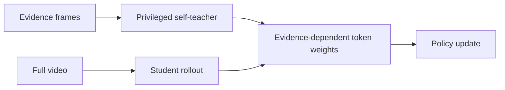
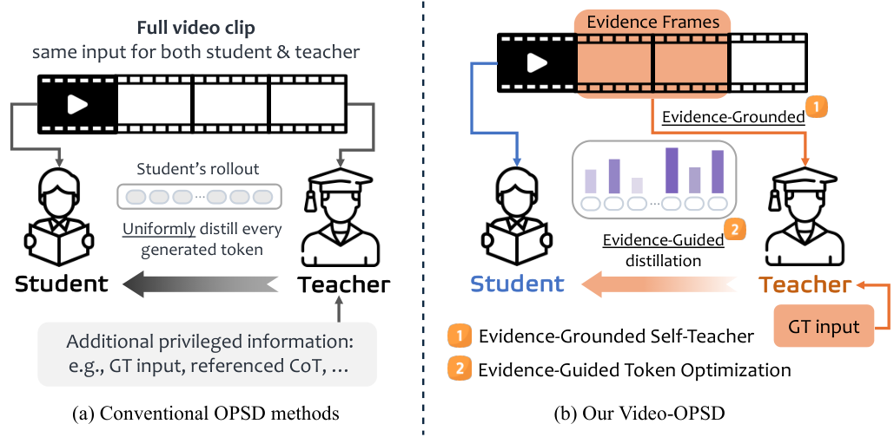

<!-- source-sha256: 82a7cae2588d9fd34fa061aadb9c9002dd4127c10cdffa1be1e16010872882a8 -->

[简体中文](README.md) · English

# Video-OPSD: Privileged self-distillation with evidence frames

> **Core mechanism mini-suite.** Implements an evidence-view self-teacher and evidence-guided token weights.

## Paper information

| Field | Details |
|---|---|
| Paper | [arXiv 2608.27065](https://arxiv.org/abs/2608.27065) |
| Institution | Nanyang Technological University (first listed affiliation of the first author) |
| First public release | 2026-08-27 (arXiv v1) |
| Author code | No public author code found on 2026-08-31. |
| Local adapter/method | `video-opsd` |
| Local reproduction code | [`src/auto_research/post_training/latest_20260831.py`](https://github.com/daiwk/auto-research/blob/main/src/auto_research/post_training/latest_20260831.py) |

## Original paper summary

### Background and main changes

The student reads the full video while the training-time self-teacher sees only human-labeled evidence frames. Distillation is weighted by each token's dependence on that evidence. The paper reports performance close to GRPO with approximately 60% less training time.



<!-- paper-figure:start -->
### Key figure from the paper

[](https://arxiv.org/html/2608.27065v1/teaser.png)

> **Figure 1:** Overall design and components. From the [paper](https://arxiv.org/abs/2608.27065); copyright belongs to the authors. Click for the source.
<!-- paper-figure:end -->

### Core equation

$$
\mathcal L_{EGO}=\sum_t w_t^{evidence}D_{KL}(p_T^t\Vert p_\theta^t).
$$

## Local reproduction

Arithmetic-smoke over 100 steps reached **0.1953 → 0.6562** accuracy, recording evidence-token weights and the teacher gap. See [metrics](metrics/arithmetic-smoke-seed42.json).

## Scope

The public smoke data has no frames. A separate reward dimension simulates evidence dependence. No video LLM was trained, and this concept check is not the paper's measured result.

## Actual video checkpoint path

`auto-research video-opsd-eval` compares full videos against privileged views from `evidence_frame_indices` on public Video-MME-v2-compatible inputs. Both arms share the pinned SmolVLM2 checkpoint and decoding budget. It reports three-seed accuracy, parse rate and answer agreement.

```bash
auto-research video-opsd-eval --annotations video-mme-v2-evidence.jsonl \
  --video-root videos --seeds 42,43,44
```

Per-question evidence annotations are mandatory; missing annotations cause failure. This audits the public checkpoint's evidence views, not the paper's full OPSD training with 6,500 examples and 8×H100. A100 acceptance used official demo clips from a pinned Video-MME-v2 revision. Repository frame labels are additional protocol annotations, not the authors' OPSD annotations. See [Video-OPSD A100 receipt](../../gpu-validations/video-opsd-checkpoint-a100-20260901.json).
