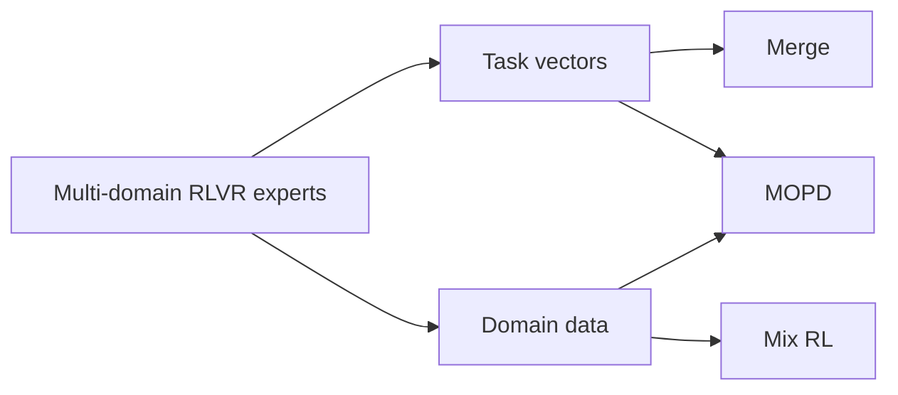
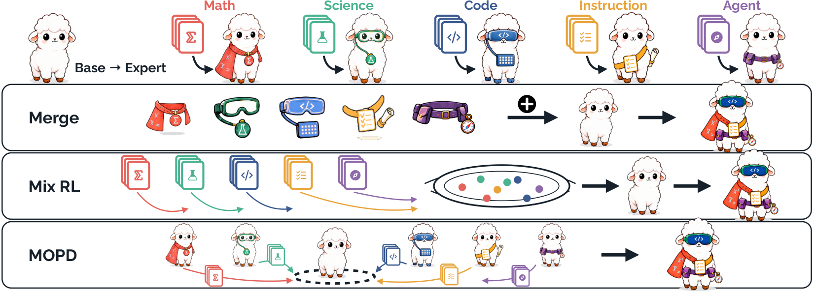

<!-- source-sha256: 7eb55502fdbd041ac9d369bc8ea95dfd6549d7787f9069cae18d7571a037e742 -->

[简体中文](README.md) · English

# RLVR Fusion: Paradigms for merging cross-domain capabilities

> **Fidelity: core-mechanism mini-suite.** It implements auditable diagnostics for all three paradigms under a fair comparison and executes the paper's recommended task-vector Merge when local domain experts are available. The three paradigms are not conflated into a new objective.

## Paper information

| Field | Details |
| --- | --- |
| Paper | [arXiv 2608.27409](https://arxiv.org/abs/2608.27409) |
| Institution | Fudan University (first-listed affiliation of the first author) / Tencent LLM Department |
| First public release | 2026-08-27 (arXiv v1) |
| Author code | [Released: LLM-Fusion](https://github.com/Di-viner/LLM-Fusion) |
| Local adapter or method key | `rlvr-fusion` |
| Local reproduction code | [`src/auto_research/post_training/latest_20260831.py`](https://github.com/daiwk/auto-research/blob/main/src/auto_research/post_training/latest_20260831.py) |

## Original paper summary

### Background and main changes

The paper compares three cross-domain capability fusion paradigms that reuse different artifacts: Merge combines expert task vectors, Mix RL combines training data, and MOPD reuses both experts and data. Average differences are at most 1.4 points but can reach 8.6 points on individual tasks, so the choice depends on expert availability, data, and cost.



<!-- paper-figure:start -->
### Key figure from the paper

[](https://arxiv.org/html/2608.27409v1/intro2.png)

> **Figure 1:** Overall design and components. From the [paper](https://arxiv.org/abs/2608.27409); copyright belongs to the authors. Click for the source.
<!-- paper-figure:end -->

### Core equations

$$
\tau_i=\theta_i-\theta_0,\qquad \theta_{merge}=\theta_0+\frac1K\sum_i\tau_i.
$$

## Local reproduction

On arithmetic-smoke with 100 steps, accuracy goes from **0.1953 to 0.2812**. The run records task-vector cosine, Mix RL advantages, and MOPD teacher-gap diagnostics. See [`metrics/arithmetic-smoke-seed42.json`](metrics/arithmetic-smoke-seed42.json).

## Scope

The local candidate policy is not a large-model checkpoint. Merge runs only when experts already exist. Mix RL and MOPD are equally budgeted, auditable diagnostics; the local run does not reproduce the paper's multi-model results at scale.

## Evaluation on real public checkpoints

The repository also supplies a single-GPU bridge that loads pinned revisions of the authors' released Qwen3-4B Base, Merge, Mix, and MOPD checkpoints, plus `Siye01/LLM-Fusion-Test`. All four use the same examples, generation budget, and three seeds:

```bash
auto-research rlvr-fusion-eval --benchmark AIME2025 \
  --maximum-examples 10 --seeds 42,43,44
```

See `src/auto_research/post_training/rlvr_fusion_eval.py` for the implementation. This compares official checkpoints on a subset on one A100. The full paper protocol has eight benchmarks, a code sandbox, and multi-GPU vLLM; the local subset is not a reproduction of its full results table. See the sanitized [RLVR Fusion A100 receipt](../../gpu-validations/rlvr-fusion-checkpoints-a100-20260901.json).
