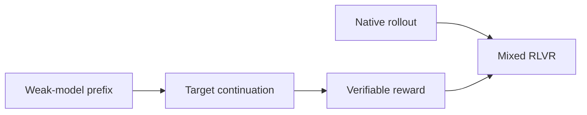
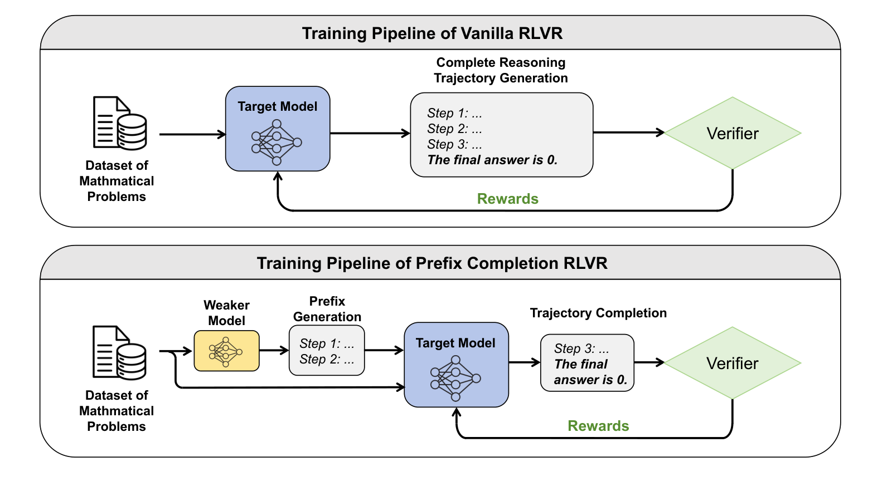

# Weak-Model Guidance: Recover RLVR exploration with weaker-model prefixes

<!-- source-sha256: 15f1921db927d3fe2f76d075dcb0f9217f486cf71bc81fa19945edd545dff0e7 -->

[简体中文](README.md)

> Core mechanism mini-suite: cross-model prefix perturbation, mixture sampling and entropy diagnostics.

## Paper information

| Field | Details |
|---|---|
| Paper | [arXiv 2608.27420](https://arxiv.org/abs/2608.27420) |
| Institution | Wangxuan Institute of Computer Technology, Peking University (first author). |
| First public release | 2026-08-27 (arXiv v1) |
| Author code | No public author implementation found as of 2026-08-29. |
| Local adapter or method key | `weak-guide-rlvr` |
| Local reproduction code | [`src/auto_research/post_training/latest_20260829.py`](https://github.com/daiwk/auto-research/blob/main/src/auto_research/post_training/latest_20260829.py) |

## Paper method and evidence

RLVR can collapse in entropy. A smaller, weaker model supplies part of the reasoning prefix, exposing the target model to unfamiliar trajectories. Entropy truncation and mixed training on native and guided samples preserve coverage.

<!-- paper-figure:start -->
### Original paper figure

Figure 2 shows guided and native rollout paths. From the [original paper](https://arxiv.org/abs/2608.27420); copyright remains with the authors.
<!-- paper-figure:end -->

### Core equation

$$
p_{mix}(y\mid x)=\rho p_\theta(y\mid x,z_{weak})+(1-\rho)p_\theta(y\mid x).
$$

### Reported results

The paper reports outperforming vanilla RLVR on several math benchmarks, with larger pass@k improvements at larger k. No industrial A/B.

## Local reproduction

The 100-step arithmetic smoke test moved from **0.1953 to 0.6797** accuracy and recorded guided entropy and prefix surprise. [Metrics](metrics/arithmetic-smoke-seed42.json) and [batch results](../../experiments/latest-20260829-seed42.json). A frozen reference distribution stands in for the weak teacher; no two-checkpoint RLVR reproduction.
