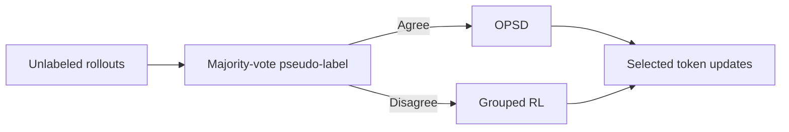
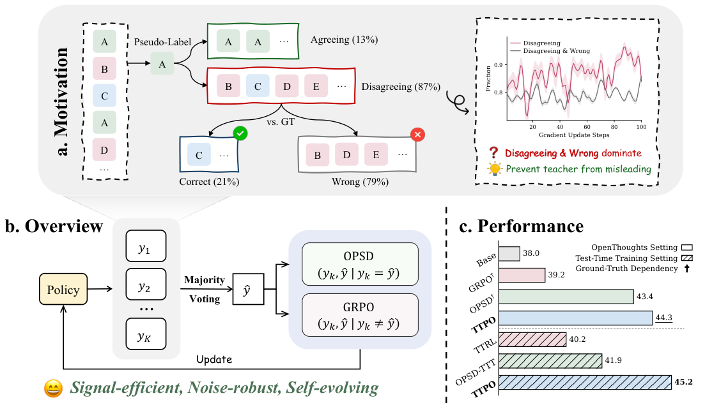

# TTPO: label-free test-time policy optimization

<!-- source-sha256: ada90da09e3d0331abe859f17d328dfc6ce66d8bade8ce7d6128c3c323cd367d -->

[简体中文](README.md)

> **Core-mechanism mini-suite.** Implements majority-vote routing, OPSD for agreeing samples, grouped RL for disagreements, and confident-error filtering.

## Paper information

| Field | Details |
|---|---|
| Paper | [arXiv 2608.27448](https://arxiv.org/abs/2608.27448) |
| Organization | Zhejiang University, the first listed affiliation of the first author; in collaboration with Alibaba |
| First public release | 2026-08-27 (arXiv v1) |
| Authors' code | [ZJU-REAL/TTPO](https://github.com/ZJU-REAL/TTPO) |
| Adapter / method | `ttpo` |
| Local reproduction code | [`src/auto_research/post_training/latest_20260829.py`](https://github.com/daiwk/auto-research/blob/main/src/auto_research/post_training/latest_20260829.py) |

## Original paper

### Motivation and method

Majority-vote pseudo-labels can be wrong, but rollouts disagreeing with the majority are usually still incorrect. TTPO applies OPSD to agreements and grouped RL to disagreements, separately filtering converged tokens and high-confidence errors.



<!-- paper-figure:start -->
### Key figure from the paper

[](https://arxiv.org/html/2608.27448v1/intro.png)

> **Figure 1:** Overview of the paper's method and key components. From the [original paper](https://arxiv.org/abs/2608.27448); copyright remains with the authors.
<!-- paper-figure:end -->

### Core equation

$$
\mathcal L=\mathbf1[a=\hat a]\mathcal L_{OPSD}+\lambda\mathbf1[a\ne\hat a]\mathcal L_{GRL}.
$$

### Paper results

Qwen3-1.7B test-time training improves on average from **38.0% to 45.2%**; the no-thinking setting improves by **25.2%–36.4%**.

## Local reproduction

Arithmetic-smoke accuracy after 100 steps goes from **0.1953 to 0.6328**. This isolates the mechanism on a candidate policy and is not the paper's mathematics benchmark.

See the [metrics](metrics/arithmetic-smoke-seed42.json) and [batch index](../../experiments/latest-20260829-seed42.json).

```bash
auto-research post-train --algorithm ttpo --dataset arithmetic-smoke --steps 100 --seed 42 --offline
```

## Reproduction boundaries

No Qwen checkpoint or real test-time rollout was used. The run checks only the asymmetric objective and token-selection path.
