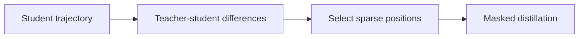
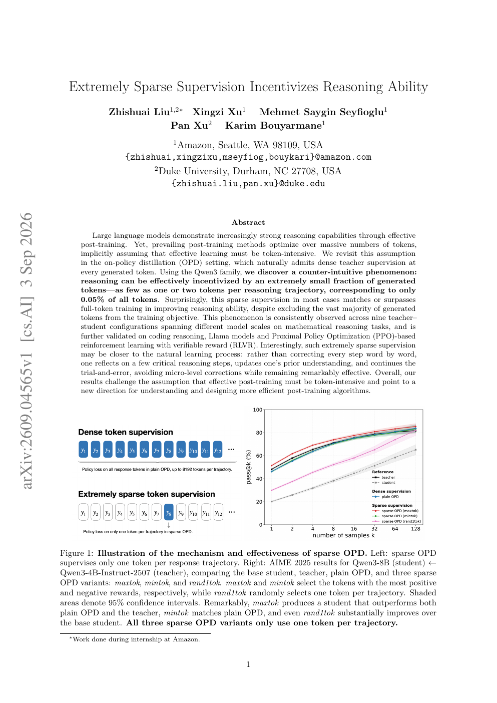

# Sparse OPD: Distilling One or Two Key Tokens per Trajectory

<!-- source-sha256: 97d5dd7b466c0a36e4458271dce14c47b250abd75aaa8ca94742756ff103b5dd -->

[简体中文](README.md)

> **Core mechanism evidence.** Paper and local evaluations are separate.

## Paper information

| Field | Value |
| --- | --- |
| Paper | [arXiv 2609.04565](https://arxiv.org/abs/2609.04565) |
| Affiliations | Amazon / Duke University; work during Amazon internship |
| First public release | 2026-09-03 (arXiv v1) |
| Authors' code | No public code repository found as of 2026-09-07. |
| Adapter / method | `sparse-opd` |
| Local code | [`src/auto_research/post_training/latest_20260907.py`](https://github.com/daiwk/auto-research/blob/main/src/auto_research/post_training/latest_20260907.py) |

## Original paper

### Background and contribution

Instead of supervising every generated token, choose one or two key positions (about 0.05%). Largest positive differences work particularly well, suggesting targeted correction rather than word-for-word matching.

<!-- paper-figure:start -->
### Key figure from the paper

Original Sparse OPD figure. From the [paper](https://arxiv.org/abs/2609.04565); copyright belongs to the authors. Not a local result.
<!-- paper-figure:end -->

### Core mechanism

On student trajectory $y$, compute teacher–student differences $d_t$. Select $S_k=\operatorname{TopK}_t(d_t)$ and optimize $\mathcal L=-|S_k|^{-1}\sum_{t\in S_k}\log p_T(y_t|y_{<t})/p_\theta(y_t|y_{<t})$.

### Paper results

Nine Qwen3 teacher/student pairs, math/code, Llama, and PPO-RLVR. Single-token maxtok exceeds dense OPD and the teacher in an example.

## Local reproduction

The shared runner implements maximum/minimum difference and random sparse selection. [Arithmetic-smoke seeds 42/43/44](metrics/arithmetic-smoke-seeds42-44.json) record counts, ratios, selection gaps, and objective values.

## Reproduction limits

Loss-mask/selection check only, not AIME/LiveCodeBench or full Qwen/Llama OPD/PPO. No advertised CUDA path.
