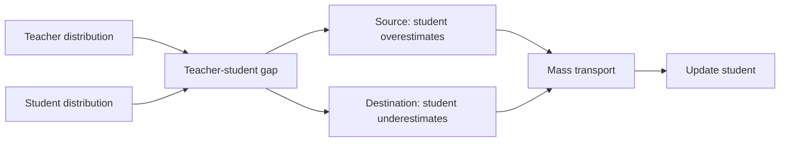
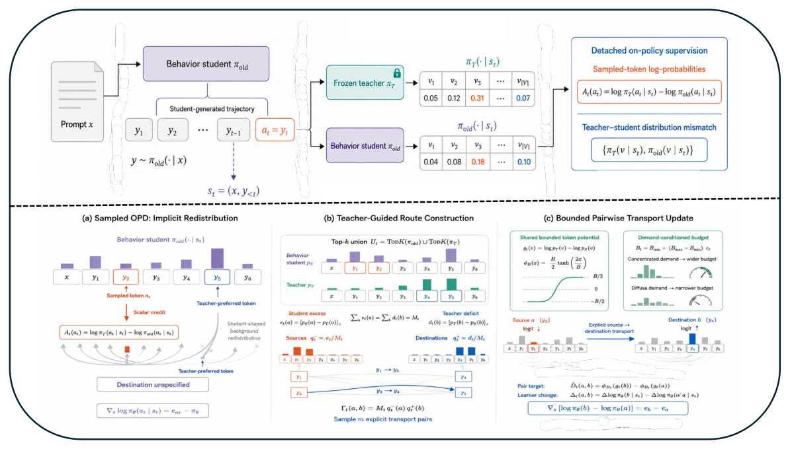

# RouteOPD: explicitly routing teacher probability mass to the student

<!-- source-sha256: 4d95b4333914d5fb16d911177f6c81c0b7d43ed7ba8b203ba07bb6d10a47d98d -->

[简体中文](README.md)

> **Candidate-policy mechanism diagnostic.** Transports probability mass from sources to destinations; does not reproduce large-model reasoning ability.

## Paper information

| Field | Details |
|---|---|
| Paper | [arXiv 2609.08337](https://arxiv.org/abs/2609.08337) |
| Organization | First-author affiliation: Tencent |
| First public release | 2026-09-08 (arXiv v1) |
| Authors' code | No public author repository was found on 2026-09-12. |
| Adapter / method | `route-opd` |
| Local reproduction code | [`src/auto_research/post_training/latest_20260912.py`](https://github.com/daiwk/auto-research/blob/main/src/auto_research/post_training/latest_20260912.py) |

## Original paper

### Motivation and method

Ordinary OPD densely matches the teacher distribution. RouteOPD identifies source tokens that the student overestimates and destination tokens it underestimates. Moving only the mass that needs correction makes supervision more targeted and interpretable.

<!-- paper-figure:start -->
### Key figure from the paper

> **Figure 2:** Overview of the paper's method and key components. From the [original paper](https://arxiv.org/abs/2609.08337); copyright remains with the authors.
<!-- paper-figure:end -->

### Core mechanism

Local supply is $s_i=[p_S(i)-p_T(i)]_+$ and demand is $d_j=[p_T(j)-p_S(j)]_+$. Transport $\min(\sum_i s_i,\sum_j d_j)$ and record `transported_mass`.

## Local reproduction and limits

See the [three-seed results](metrics/arithmetic-smoke-seeds42-44.json). The paper's full-parameter models, real rollouts, and public reasoning benchmarks were not run. The diagnostic only verifies finite outputs and execution of the routing operator.
