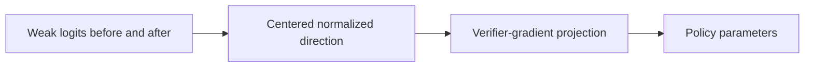
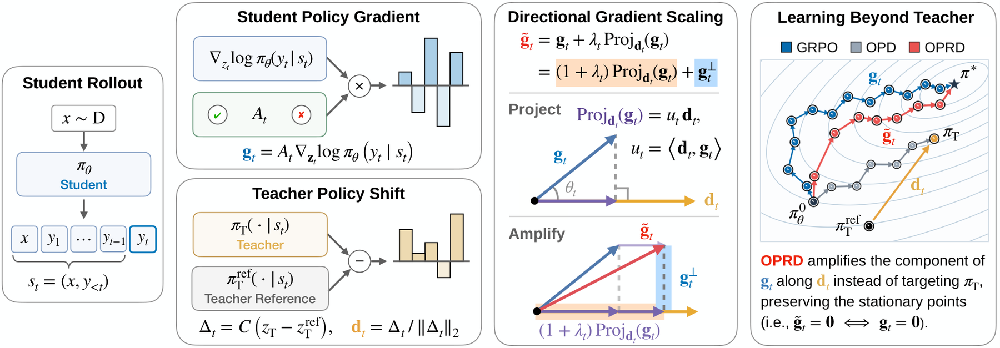

# OPRD: Using a Weak Model's Learning Direction to Improve Verifier Gradients

<!-- source-sha256: b886dd3ef50bfc50eaad76a9fa318cb4f3b27572b8412420abf3909f7a67d738 -->

[简体中文](README.md)

> **Core mechanism evidence.** Paper and local evaluation are separate.

## Paper information

| Field | Value |
| --- | --- |
| Paper | [arXiv 2609.08798](https://arxiv.org/abs/2609.08798) |
| Affiliations | KAIST AI, first author's affiliation |
| First public release | 2026-09-08 (arXiv v1) |
| Authors' code | No public repository found as of 2026-09-12. |
| Adapter / method | `oprd` |
| Local code | [`src/auto_research/post_training/latest_20260912.py`](https://github.com/daiwk/auto-research/blob/main/src/auto_research/post_training/latest_20260912.py) |

## Original paper

### Background and contribution

Do not imitate weak answers directly. Extract a weak model's before/after post-training logit direction and amplify the strong model's verifiable-reward gradient along it. Learning direction may transfer better than final capability.

<!-- paper-figure:start -->
### Key figure from the paper

Original Figure 2: OPRD. From the [paper](https://arxiv.org/abs/2609.08798); copyright belongs to the authors. Not a local result.
<!-- paper-figure:end -->

### Core mechanism

Let $d=\operatorname{normalize}((z_{W_1}-z_{W_0})-\operatorname{mean}(z_{W_1}-z_{W_0}))$; update with $g'=(I+\lambda dd^\top)g$.

### Paper results

The paper reports 33%–67% fewer updates to matched performance, up to +22.7 pp early, and about 55% fewer updates with multiple teachers. Not local NumPy metrics.

## Local reproduction

[Three-seed results](metrics/arithmetic-smoke-seeds42-44.json) verify projection per candidate and feature mapping back to policy parameters.

## Reproduction limits

Labeled candidate diagnostic, `diagnostic_only=true`, not a full LLM result or promotion evidence.
