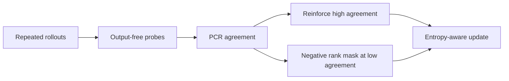
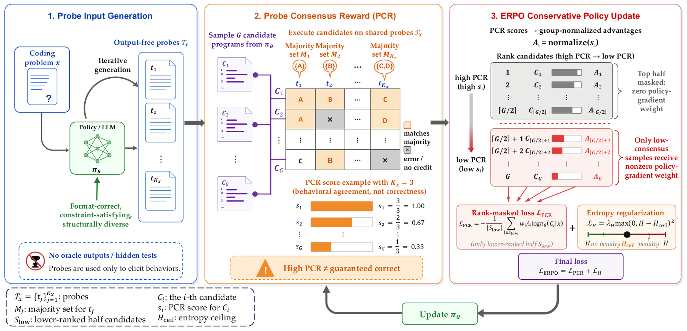

# Probe-ERPO: Output-Free Probes for Test-Time Reinforcement

<!-- source-sha256: a3aa21448b9a8972a63000c3a6147b0224bb3c9c0bb25271b092c6fef33474b2 -->

[简体中文](README.md)

> **Policy-update diagnostic with PCR supplied.** No execution probes are run.

## Paper information

| Field | Value |
| --- | --- |
| Paper | [arXiv 2609.09135](https://arxiv.org/abs/2609.09135) |
| Affiliations | Nanyang Technological University, first author's affiliation |
| First public release | 2026-09-08 (arXiv v1) |
| Authors' code | No public author repository found as of 2026-09-12. |
| Adapter / method | `probe-erpo` |
| Local code | [`src/auto_research/post_training/latest_20260912.py`](https://github.com/daiwk/auto-research/blob/main/src/auto_research/post_training/latest_20260912.py) |

## Original paper

### Background and contribution

Estimate question reliability via a probe consistency ratio (PCR) without using final answers. Reinforce high-consistency samples, penalize lower-ranked candidates at low consistency, and constrain exploration with entropy.

<!-- paper-figure:start -->
### Key figure from the paper

Original Figure 2: probe and update flow. From the [paper](https://arxiv.org/abs/2609.09135); copyright belongs to the authors. Not a local result.
<!-- paper-figure:end -->

### Core mechanism

The fixture supplies the PCR axis. The mechanism applies the low-agreement negative-rank mask and checks the entropy direction.

### Paper results

The code-execution probe and complete TTRL/ERPO path were not evaluated.

## Local reproduction

See [three-seed arithmetic smoke metrics](metrics/arithmetic-smoke-seeds42-44.json).

## Reproduction limits

No code-execution probes; not a full TTRL/ERPO reproduction.
