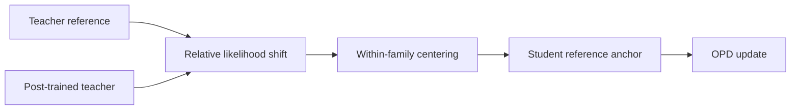
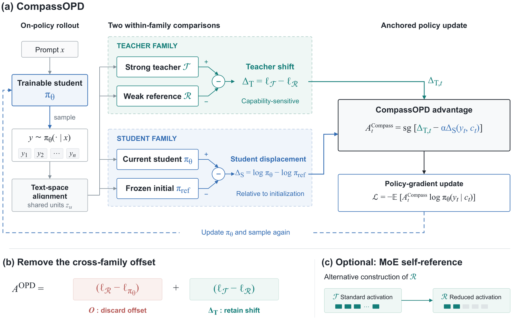

# CompassOPD: Align relative teacher directions across model families

<!-- source-sha256: 77f6f61759bf163d6ba0f40e29bfebd761fe45c58324ae8d021d601ff186442c -->

[简体中文](README.md)

> L1 candidate-policy diagnostic, not full cross-tokenizer LLM training.

## Paper information

| Field | Details |
|---|---|
| Paper | [arXiv 2609.10154](https://arxiv.org/abs/2609.10154) |
| Institution | Institute of Information Engineering, Chinese Academy of Sciences (first author). |
| First public release | 2026-09-09 (arXiv v1) |
| Author code | No public author repository found as of 2026-09-12. |
| Local adapter or method key | `compass-opd` |
| Local reproduction code | [`src/auto_research/post_training/latest_20260912.py`](https://github.com/daiwk/auto-research/blob/main/src/auto_research/post_training/latest_20260912.py) |

## Paper method and evidence

Absolute probability scales differ across model families. Compare the post-trained teacher against its reference, then center the change within its family to remove a global offset while retaining the direction.

<!-- paper-figure:start -->
### Original paper figure

Figure 2 shows how relative teacher changes anchor the student update. From the [original paper](https://arxiv.org/abs/2609.10154); copyright remains with the authors.
<!-- paper-figure:end -->

### Core equation

Compute $\Delta=z_{T_1}-z_{T_0}$ and center it as $\Delta-\mathbb E[\Delta]$. The local diagnostic records the resulting correction as `centered_cross_family_gap`.

## Local reproduction

[Three-seed arithmetic diagnostic](metrics/arithmetic-smoke-seeds42-44.json) uses a shared finite action space. No cross-tokenizer mapping or full-parameter training.
