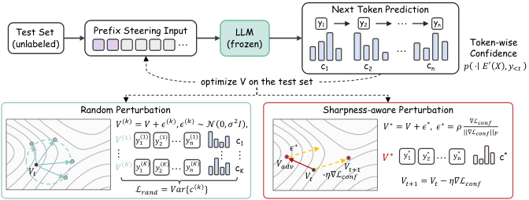

# Beyond Confidence: Stability-Aware Test-Time Adaptation for LLM Reasoning

<!-- source-sha256: 3f9d0e94c11e615a66b77d89577a14ab5411722dad005d44f57a3191cc25f018 -->

[简体中文](README.md)

> L1 neighborhood perturbation and stability penalty; no actual frozen LLM prefix loaded.

## Paper information

| Field | Details |
|---|---|
| Paper | [Beyond Confidence: Stability-Aware Test-Time Adaptation for LLM Reasoning](https://arxiv.org/abs/2609.11393) |
| Institution | Chongqing University (first author). |
| First public release | 2026-09-10 (arXiv v1) |
| Author code | No public author repository found as of 2026-09-14. |
| Local adapter or method key | `tasco` |
| Local reproduction code | [`src/auto_research/post_training/latest_20260914.py`](https://github.com/daiwk/auto-research/blob/main/src/auto_research/post_training/latest_20260914.py) |

## Paper method and evidence

Freeze the base model and optimize a lightweight prefix. Penalize instability under neighborhood perturbations as well as low confidence, to avoid confident but incorrect trajectories.

<!-- paper-figure:start -->
### Original paper figure

Figure 3 shows the test-time adaptation process. From the [original paper](https://arxiv.org/abs/2609.11393); copyright remains with the authors.
<!-- paper-figure:end -->

### Core equation

The deterministic reference emits decisions and state statistics and tests mathematical invariants and boundaries.

### Reported results

Paper results are author measurements, not fixture scores.

## Local reproduction

[Three-seed mechanism results](metrics/mechanism-seeds42-44.json) are diagnostic_only=true. Fixed-budget fixtures verify the defining operator and auditable intermediate states; they are not a benchmark, production result, or capability-ranking entry. All candidates use the same public fixtures, budget, and seeds.
