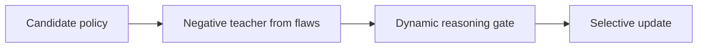
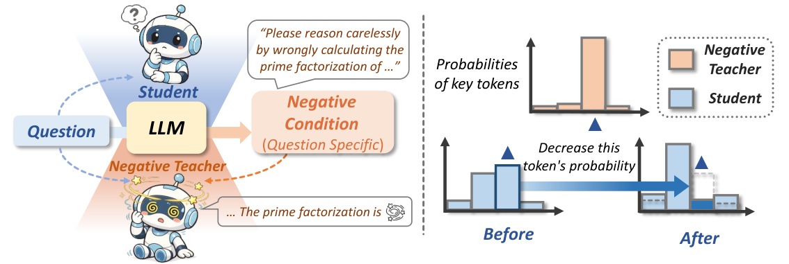

# Negative Self-Distillation: Learning to Reason by Avoiding Flaws

<!-- source-sha256: c62af59c5a697409c2ea47897079ff02c0968efc8b6233f1b4a7a7c84a5dd47f -->

[简体中文](README.md)

> **Local core-mechanism evidence.** Paper outcomes and local results are separate.

## Paper information

| Field | Value |
| --- | --- |
| Paper | [Negative Self-Distillation: Learning to Reason by Avoiding Flaws](https://arxiv.org/abs/2609.11699) |
| Affiliations | University of Virginia |
| First public release | 2026-09-10 |
| Authors' code | [Authors' code](https://github.com/Prongcan/NSD). |
| Adapter / method | `nsd` |
| Local code | [`src/auto_research/post_training/latest_20260914.py`](https://github.com/daiwk/auto-research/blob/main/src/auto_research/post_training/latest_20260914.py) |

## Original paper

### Background and contribution

Move the student away from its own flawed reasoning distribution. A dynamic gate limits updates to reasoning-relevant positions to avoid forgetting ordinary language.

<!-- paper-figure:start -->
### Key figure from the paper

Original Figure 1: Negative Self-Distillation. From the [paper](https://arxiv.org/abs/2609.11699); copyright belongs to the authors. Not a local result.
<!-- paper-figure:end -->

### Core mechanism

Construct the negative teacher and dynamic reasoning-position gate. Tests inspect gate, selection, and state invariants.

### Paper results

Average gains on seven math benchmarks for 1.7B/4B/8B were 2.3%/7.5%/6.0% in the paper. No local comparison or inferred online A/B.

## Local reproduction

[Three-seed metrics](metrics/mechanism-seeds42-44.json) use matched public fixtures, budgets, and seeds. The deterministic kernel exposes gates and update statistics.

## Reproduction limits

L1 negative-teacher/gate diagnostic only; no full-parameter LLM training.
