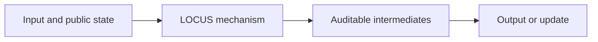
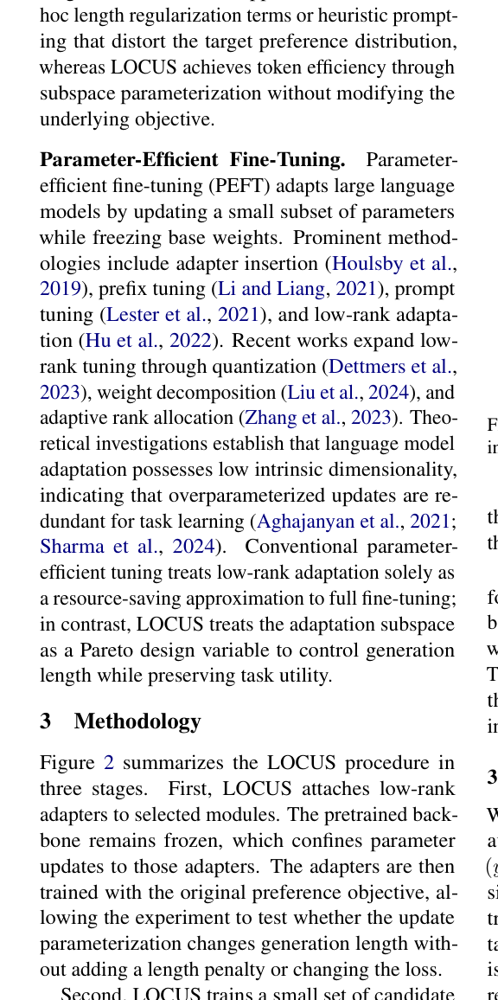

# LOCUS: Task-Aware Low-Rank Post-Training for Token-Efficient Language Generation

<!-- source-sha256: ee254aec01d323958e2cbc0cc360afc5d128905c1b043252bc0e34620ef6734a -->

[简体中文](README.md)

> **L1 core-mechanism diagnostic.** Projects policy gradients with example-feature SVD; does not train a paper-scale language model.

## Paper information

| Field | Details |
|---|---|
| Paper | [LOCUS: Task-Aware Low-Rank Post-Training for Token-Efficient Language Generation](https://arxiv.org/abs/2609.11739) |
| Organization | First-author affiliation: University of Washington |
| First public release | 2026-09-10 |
| Authors' code | No public author repository was found on 2026-09-14. |
| Adapter / method | `locus` |
| Local reproduction code | [`src/auto_research/post_training/latest_20260914.py`](https://github.com/daiwk/auto-research/blob/main/src/auto_research/post_training/latest_20260914.py) |

## Original paper

### Motivation and method

Learn a task-related low-rank post-training subspace. Updating only compact directions shortens responses while retaining task capabilities.

<!-- paper-figure:start -->
### Key figure from the paper

> **Figure 2:** Overview of the paper's method and key components. From the [original paper](https://arxiv.org/abs/2609.11739); copyright remains with the authors.
<!-- paper-figure:end -->

### Core computation or operation

The local code implements the decisive operation as a deterministic reference kernel and explicitly reports gate, selection, projection, graph-edge, or state-update statistics. Tests cover formula invariants and boundary conditions.

### Paper results

Pythia outputs shorten by up to 39.84% and Qwen by 14.87%–17.58%, with about 0.24%–0.28% trainable parameters. These are paper results, not directly comparable with the scaled-down local run. No online gains are inferred in the absence of an online A/B test.

## Local reproduction

See the [three-seed metrics](metrics/mechanism-seeds42-44.json). All candidates share the public fixtures, budget, and seeds. The results verify actual execution of core state transitions only.

### Reproduction boundaries

Local code projects policy gradients with example-feature SVD. No paper-scale language model was trained.
