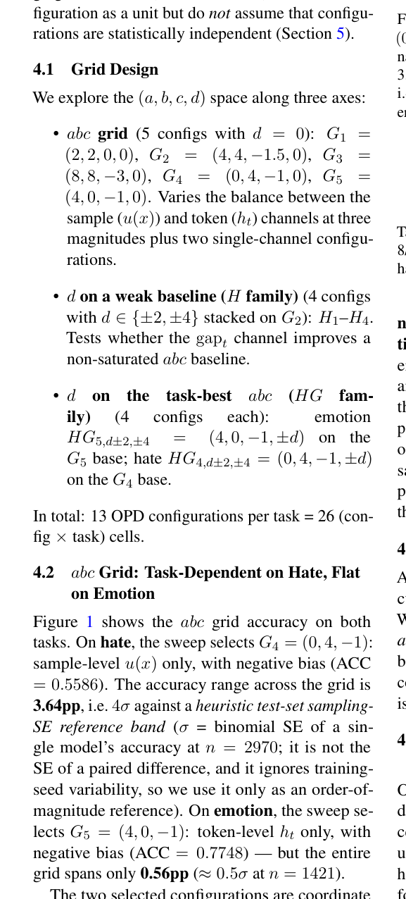

# A Unified Per-Token Gating Family for On-Policy Distillation: FKL/RKL Mixing with Multi-Channel and Bias Coefficients

<!-- source-sha256: 191b0a47d2684a6eb3a5d18ba2b668db1df9470e4ff14d986295dc12b31c63c1 -->

[简体中文](README.md)

> **L1 core-mechanism diagnostic.** Runs the four-signal gate. Exploratory results do not establish a stable win.

## Paper information

| Field | Details |
|---|---|
| Paper | [A Unified Per-Token Gating Family for On-Policy Distillation: FKL/RKL Mixing with Multi-Channel and Bias Coefficients](https://arxiv.org/abs/2609.11768) |
| Organization | First-author affiliation: Xiaohongshu |
| First public release | 2026-09-10 |
| Authors' code | No public author repository was found on 2026-09-14. |
| Adapter / method | `adaptive-opd-gate` |
| Local reproduction code | [`src/auto_research/post_training/latest_20260914.py`](https://github.com/daiwk/auto-research/blob/main/src/auto_research/post_training/latest_20260914.py) |

## Original paper

### Motivation and method

Combine entropy, uncertainty, reference deviation, and teacher–student gap in a per-token gate, adaptively assigning weight between forward and reverse KL.

<!-- paper-figure:start -->
### Key figure from the paper

> **Figure 1:** Training flow and key optimization steps. From the [original paper](https://arxiv.org/abs/2609.11768); copyright remains with the authors.
<!-- paper-figure:end -->

### Core computation or operation

The local deterministic reference kernel implements the decisive operation and reports gate, selection, projection, graph-edge, or state-update statistics. Tests cover formula invariants and boundaries.

### Paper results

The paper reports wins in 33/36 exploratory cells and 19/26 mean-matched static comparisons; some main three-seed comparisons were not significant. These paper results are not directly comparable with the scaled-down local run. No online gain is inferred without an online A/B test.

## Local reproduction

See the [three-seed metrics](metrics/mechanism-seeds42-44.json). All candidates use identical public fixtures, budgets, and seeds. These results establish only execution of the core state transitions.

### Reproduction boundaries

The four-signal gate runs locally. Exploratory diagnostics are not stable performance gains.
