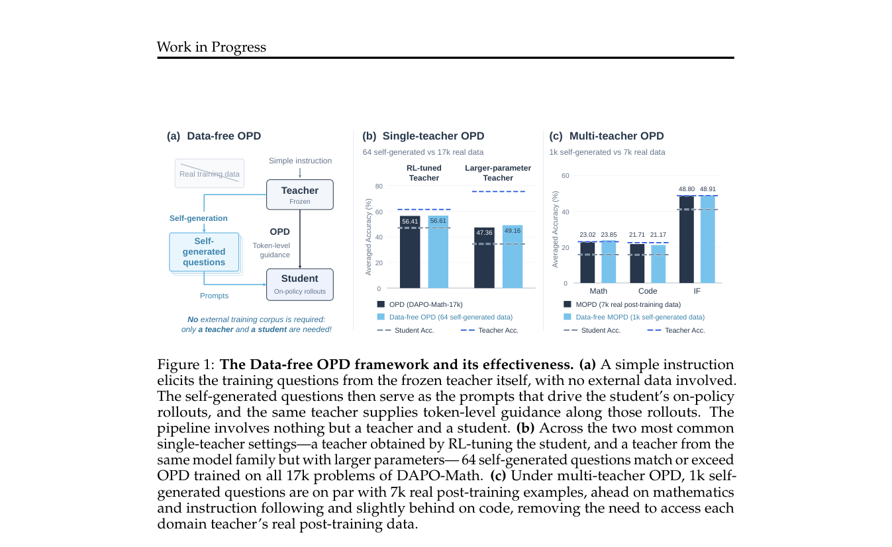

# Data-free On-policy Distillation

<!-- source-sha256: 693bbf898acc148c7eb424ea278efdd30d6d201da32898ef54657b560d2ab4b0 -->

[简体中文](README.md)

> **L1 mechanism diagnostic.** A diagnostic of policy features on self-generated questions, without producing a natural-language dataset.

## Paper information

| Field | Value |
| --- | --- |
| Paper | [Data-free On-policy Distillation](https://arxiv.org/abs/2609.14193) |
| Affiliations | Institute of Automation, Chinese Academy of Sciences / Tencent |
| First public release | 2026-09-12 (arXiv v1) |
| Authors' code | No public author repository found as of 2026-09-16. |
| Adapter / method | `df-opd` |
| Local code | [`src/auto_research/post_training/latest_20260916.py`](https://github.com/daiwk/auto-research/blob/main/src/auto_research/post_training/latest_20260916.py) |

## Original paper

### Background and contribution

Have the teacher generate questions in its own policy space, reducing dependence on external post-training corpora.

<!-- paper-figure:start -->
### Key figure from the paper

Original Figure 1: data-free distillation workflow. From the [paper](https://arxiv.org/abs/2609.14193); copyright belongs to the authors. Not a local result.
<!-- paper-figure:end -->

### Core mechanism

The reference preserves defining gate, weighting, and state transitions and reports auditable intermediates under fixed budgets. Three seeds test mechanism invariants, not paper-scale training.

### Paper results

The authors' capability, speed, and cost are not local measurements or online gains.

## Local reproduction

[Three-seed results](metrics/mechanism-seeds42-44.json) are marked `diagnostic_only=true` and do not establish full capability.

## Reproduction limits

No natural-language training set is generated locally.
