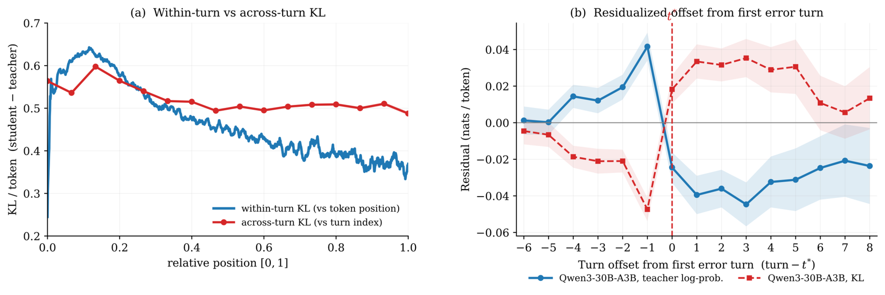

# Know When to Stop, Where to Restart: Accelerating Multi-Turn Agentic On-Policy Distillation

<!-- source-sha256: bd0aaaa90661f40c15461fe93584d74169d784a017bad6e6dcb5a48fa1ab2249 -->

[简体中文](README.md)

> **L1 core-mechanism diagnostic.** Implements early stopping and prefix restart, not large-model rollout throughput.

## Paper information

| Field | Details |
|---|---|
| Paper | [Know When to Stop, Where to Restart](https://arxiv.org/abs/2609.14636) |
| Organization | First-author affiliations: University of Science and Technology of China / Ant Group |
| First public release | 2026-09-13 (arXiv v1) |
| Authors' code | No public author repository was found as of 2026-09-16. |
| Adapter / method | `stride-opd` |
| Local reproduction code | [`src/auto_research/post_training/latest_20260916.py`](https://github.com/daiwk/auto-research/blob/main/src/auto_research/post_training/latest_20260916.py) |

## Original paper

### Motivation and method

Stop early when accumulated teacher confidence crosses the threshold, then restart at the cached prefix of the weakest correct turn.

The local reference kernel retains decisive gates, weights, or state transitions and outputs auditable intermediates for comparisons under a common budget.

~~~mermaid
flowchart LR
  I[Public input and state] --> M[Stride-OPD mechanism]
  M --> A[Auditable intermediates]
  A --> O[Output or policy update]
~~~

<!-- paper-figure:start -->
### Key figure from the paper

> **Figure 2:** Overall method and key components. From the [original paper](https://arxiv.org/abs/2609.14636); copyright remains with the authors.
<!-- paper-figure:end -->

### Core computation

The implementation keeps the decisive transitions and reports weights, gates, depth, stages, or cache statistics. Fixed budgets and three seeds check mechanism invariants only, not paper-scale training.

### Paper results

The paper's capability, speed, and cost findings are author evidence only. Local metrics are not directly compared or extrapolated to online gains.

## Local reproduction

See the [three-seed artifact](metrics/mechanism-seeds42-44.json). The common receipt has `diagnostic_only=true`, so the public dashboard does not treat it as a full capability gain.

### Reproduction boundaries

Early stopping and prefix restart run locally. Large-model rollout throughput has not been reproduced.
