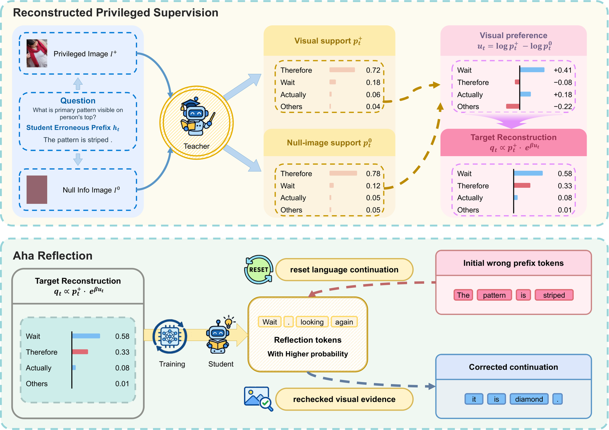

<!-- source-sha256: bcbecef77a7befae4d493f2d620400463741d704a0a213f1b1cccbd77a06d1c8 -->

[简体中文](README.md) · English

# OPD-Aha: From Linguistic Momentum to Visual Reflection in Multimodal On-Policy Distillation

> **L1 core mechanism diagnostic.** The target reconstruction formula runs locally. No multimodal checkpoint was loaded.

## Paper information

| Field | Details |
|---|---|
| Paper | [OPD-Aha: From Linguistic Momentum to Visual Reflection in Multimodal On-Policy Distillation](https://arxiv.org/abs/2609.16459) |
| Institutions | Arizona State University / University of Virginia / Stevens Institute of Technology (first author affiliations) |
| First public release | 2026-09-15 (arXiv v1) |
| Original source code | Yes: [Echochef/OPD-Aha](https://github.com/Echochef/OPD-Aha) |
| Adapter/method | `opd-aha` |
| Local reproduction code | [`src/auto_research/post_training/latest_20260916.py`](https://github.com/daiwk/auto-research/blob/main/src/auto_research/post_training/latest_20260916.py) |

## Original paper summary

### Background and main changes

Reconstruct a visually preferred target from the difference between the teacher's distributions with actual and empty visual input. This counters momentum from an incorrect linguistic prefix.

The local reference kernel retains the defining gates, weights or state transitions and emits auditable intermediates for comparison under a shared budget.

<!-- paper-figure:start -->
### Key figure from the paper

> **Figure 2:** Core architecture, components and connections. From the [paper](https://arxiv.org/abs/2609.16459); copyright belongs to the authors. Click for the source.
<!-- paper-figure:end -->

### Core mechanism

The implementation preserves the defining state transition and exposes relevant weight, gate, depth, stage or cache statistics. Fixed budgets and three seeds check mechanism invariants, not paper-scale training.

### Offline and online results

Capability, speed and cost claims are attributed to the paper only. Local metrics are not directly compared or extrapolated to online gains.

## Local reproduction

See [`metrics/mechanism-seeds42-44.json`](metrics/mechanism-seeds42-44.json). The unified receipt marks `diagnostic_only=true`, so the public dashboard does not treat this as a complete capability gain.

### Scope

The target reconstruction formula runs locally; no multimodal checkpoint was loaded.
